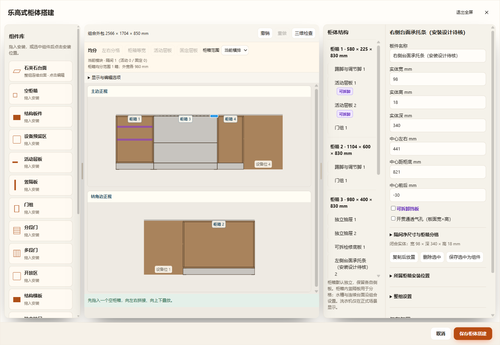
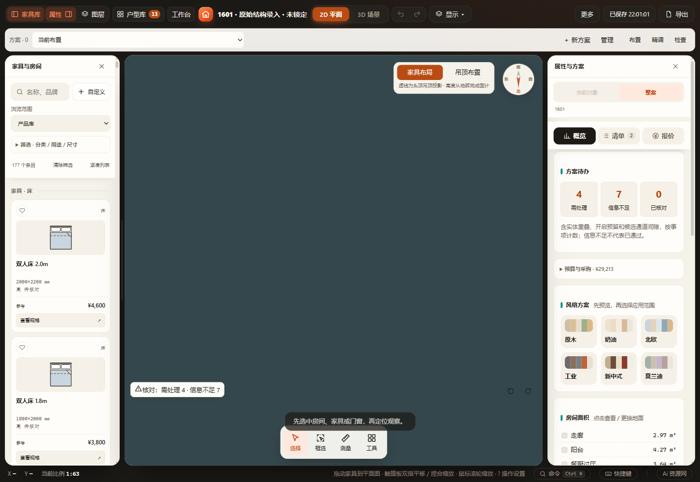

# 1601 灶下承托、隔板与抽屉复查

2026-11-13。检查当前TH36B-T与B柜的实际生产结构，不把型号外包、石材开孔或面板占地当作灶体。正式读取为`custom_mv37igji / dmwd80ij0`，厨房`fmv9dos7j1`、灶具`fmv9r1fzz1`。正式文件为`D:\1601装修\Furnish项目\workspace.furnish.json`；用户结束柜体草稿后，通过专用MCP应用修正并保存成功。

## 结论及修改

生产灶具下机身650×340×80mm，台面基准850mm，机身下沿770mm；这些是既有型号模型参数，非本轮新增厂家安装结论。当前灶具相对B柜中心向左5mm、向后60mm，不能用模块中心代替实际安装位置。

| 部位 | 真实关系／原问题 | 本轮处理 |
| --- | --- | --- |
| 左右承托条 | 原80×340×18mm、中心X±432、板底812；侧板顶812。承托条只到内侧面X±472，与侧板仅线接触，底面承托面积0 | 改98×340×18mm、中心X±441，内边缘X±392不动，外边缘至柜外沿X±490。每条覆盖18mm侧板厚，底面承托面积6120mm²；顶830仍接石材底 |
| 灶体与承托条 | 灶体相对柜箱X范围−330至320，距承托条内边缘左62／右72mm | 加宽仅向外，间隙不变，不截短或删除承托条 |
| 灶下隔板 | 板底730／顶748，距灶体底770有22mm；前沿161，抽面背182 | 保留厚度、标高及可拆状态，无灶体穿板 |
| 灶前通风挡板 | 后沿146／前沿164，灶体前沿相对柜箱110，水平间隙36；抽面背182，通道18 | 保留原42孔及结构，不因灶具孔误删挡板 |
| 内抽 | 顶720，距隔板底730有10mm，距灶体底770有50mm | 保留结构，核对闭合至完全拉出全过程 |
| 碗碟／锅具外抽 | 抽面背与挡板、隔板、承托条前沿分离；完整水平运动保持高度关系 | 保留原抽面、抽盒及标高，不压缩收纳空间掩盖冲突 |

仅两条承托板各修改`w`、`x`，沿既有结构字段，无新格式或全局默认值。案例夹具同步，旧负例在测试中还原80mm／±432mm。仍保留“安装设计待核”名称：几何有承托面不等于材料、紧固和石材承重已核准。22／10／36mm等均为模型结果，不是厂家燃气、散热、接口或隔热要求；软管及接口位置仍须实测。

## 验证与证据

- `test-hob-cabinet-structure.cjs`：12组旋转0／37／180°、镜像与0／120mm抬高，读取真实生产网格顶点；闭合柜板与实际灶体／玻璃分层检查、承托面积检查，内外抽每块板全行程与固定板／灶体求交。直线扫掠由两端同一稳定板件顶点凸包构成，不只检查端态。数值实体、项目／命名方案往返通过；保留旧承托面积0和隔板上移穿灶体负例。
- `test-hob-cabinet-structure-ui.cjs`：HTTP、断网file、同正式EXE隔离桌面。真实修改两条承托板、草稿撤销／重做、保存、应用撤销／重做、刷新恢复、生产承托面积与灶体标高、三份正式GLB导出通过。
- UI内调用`helpers/read-hob-structure-glb.cjs`：独立解码三份GLB的位置、节点矩阵和稳定家具／部件身份，重算两个承托面、隔板22mm间隙及灶体穿板范围，不重新调用生产构造器。
- 原`test-cabinet-service-details.cjs`与`test-kitchen-hob-opening.cjs`通过，42孔、内抽15姿态和24组石材／柜顶孔保持。

完整三入口每个12项，见[result.json](result.json)、[生产矩阵](production-result.json)和[GLB回读](glb-readback.json)。运行目录`output/desktop-verification/hob-cabinet-structure-LRTXZH`，三份GLB留在该目录。

未运行全项目检查；未执行Blender工程回读或燃气安装／承重认证。没有修改灶具模型、开孔或应用碰撞规则。

## 正式应用状态

用户回复已保存并关闭，窗口随后重开。重读最新正式方案后，仅合入两条承托板四个数值，MCP回执`applied:true / persisted:true`，2026-11-13 22:19:29保存成功；再次读取全家具递归差异仅`80→98`、`−432→−441`、`80→98`、`432→441`。其余家具和柜内状态保持，新增一次可撤销修改。回执摘要与具体路径见[applied.json](applied.json)。已交接照明会话从修正后的最新方案复制，不用修复前快照覆盖。原隔离项目副本继续保留。
