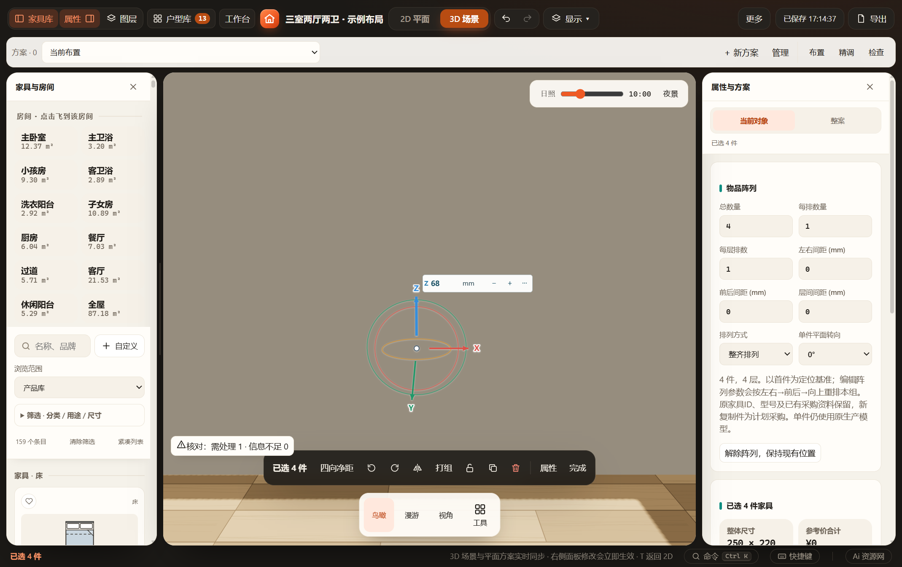
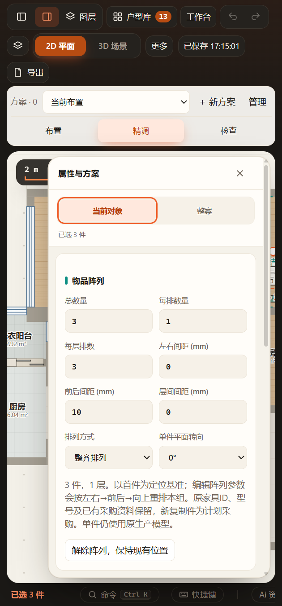

# 关联物品阵列验收（2026-11-07）

契约与当前方案数量见 [INVENTORY-ARRAY](../../INVENTORY-ARRAY.md)。仅扩展三类现有物品的关联生成工具，纸品沿原内部阵列；未重做Blender资产或改变单品结构。

## 通过

- `tests/test-inventory-array.cjs`：猫砂、猫粮、收起折叠椅的精确原位转换／生产实体／原确认指纹，0／37／90／180度及镜像，数量与末层、网格／错位、三向间距及平面转向，无朝向累积；锁定与图层、新件继承图层、保留采购、复制独立身份、解除、非法输入、200件上限、v63当前／命名方案往返、重复恢复。
- `tests/test-inventory-array-ui.cjs`：正式发布目录同一EXE，独立工作目录／端口／缓存／数据；MCP一次转换并保存，转换前后逐部件生产GLB世界边界匹配，界面修改数量／排列／间距／转向、一次撤销重做保留阵列选择、错误输入、锁定、保存刷新、窄屏及解除。HTTP及阻断HTTP网络的file入口加载可编辑。[UI报告](ui-report.json)，原导出和完整截图在 `output/playwright/inventory-array-l2bIDJ/`。
- 原纸品、产品规则、三维姿态及其真实生产、家具分组、替换、工作区保存／恢复和MCP协议的增量回归；改动源与测试语法检查。
- 当前正式方案沿Furnish专用MCP先读revision再一次批量执行12项配置，实际回执 `applied:true / persisted:true`，保存成功，撤销栈增加一次。23条目标记录新增字段之外无差异，全部109条家具原字段及ID不变；219个实际生产部件逐顶点比较最大浮点差约0.0001mm。[正式数值回执](formal-verification.json)。完整只读前后快照、请求和预演分别保留于本机 `output/inventory-array-formal-*-20261107.json`，不覆盖原正式JSON。
- 通过native computer-use刷新已保存窗口，实际查看正式方案三把折叠椅的阵列数量3、每排1、每层3排、零间距及0度面板。正式方案没有用于改变数量、移动、保存往返等自动化试验。

成功批次已清理独立源码和缓存，保留报告、截图、GLB及测试项目；早期选择恢复缺陷和窗口resize尚未稳定的调试批次按约定保留。原选择恢复缺陷已修复并在最终批次复验。

## 未执行及边界

未运行全量检查，未新增Blender几何／资产发布，未为相同生产单品再次进行整套材质渲染或下载工程验收；本轮验证生产GLB的转换前后逐部件一致，纸品原回读链沿上一轮验收。阵列参数修改会按首件和配方重排，不是约束求解器；不同单品规格／姿态拒绝统一生成。柜内净距和实物承重／堆放稳定性未被阵列功能认证。正式核对原有1项猫粮占地重叠提示保持，不移动物品消除提示。
