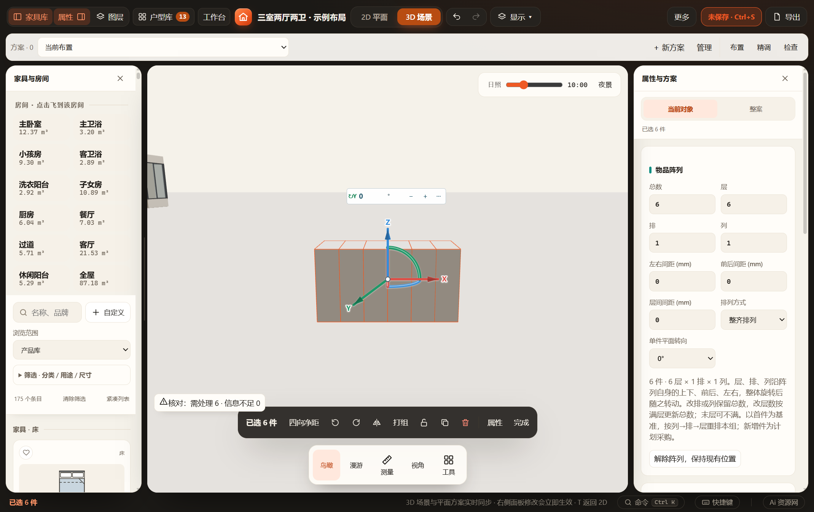
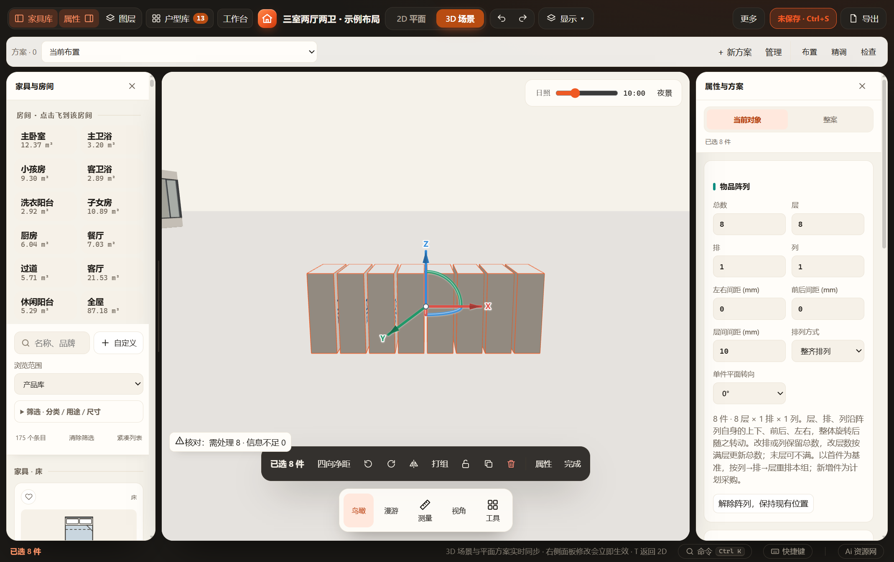
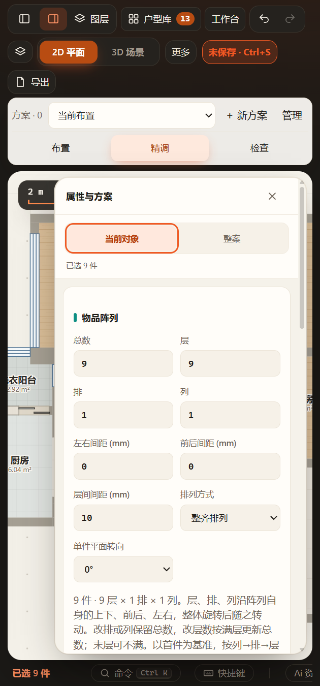

# 阵列旋转后编辑回归（2026-11-08）

## 缺陷与修复

关联阵列单件已通过pose3D整体倾斜，但再次编辑时，原inventoryPositions只处理平面yaw，并把层高加在世界竖轴上，造成排布错位。现沿同一pose旋转列／排／层间隔，并用首件真实生产中心补偿单件转向后的包络变化。向下扩展超过零离地时统一抬高，保留刚性排列。契约见[阵列文档](../../INVENTORY-ARRAY.md#整体旋转后编辑2026-11-08)。

## 增量验证

- 新增`tests/test-inventory-array-rotation.cjs`：猫砂、湿巾、方块；三个轴37°／±90°／180°、镜像、单件90°转向后的旋转、连续不同轴旋转及后续yaw。修改数量、三向间距、行列／错位应与“先改参数再做同一刚性旋转”等价，逐生产顶点比较误差小于0.00002mm；原输入不变、重复编辑不累积漂移、单件转向中心、项目往返、向下扩展全组抬高通过。
- 以HEAD旧design-core加载该新测试，第一组非水平旋转后的同数量编辑即失败，中心坐标6356.8763与6328.6404不同；修复后完整通过。不是只增加不会触发原缺陷的断言。
- `test-inventory-array.cjs`、`test-product-pose.cjs`、`test-selection-transform.cjs`和`test-paper-array.cjs`通过；改动脚本语法检查通过。未运行全量检查。
- `test-inventory-array-rotation-ui.cjs`使用同一打包EXE、独立工作目录／缓存／端口及既有户型的隔离记录：通过真实Y旋转手柄将6件整组转90°，界面改为8件和10mm层间距，仍沿旋转后方向排列；单件转向、两次撤销／重做、保存刷新后增至9件、420px面板通过。HTTP与阻断HTTP网络的file入口验证37°倾斜后改数量／间距。[完整报告](ui-report.json)。
- 正式生产GLB逐个成员、逐部件世界边界与同一姿态的数值实体匹配，误差小于0.1mm；完整导出保留在 `output/playwright/array-rotation-r7OCqd/rotated-array.glb`。实际查看本目录宽／窄屏图，6件变8件没有重新沿世界竖轴堆叠，面板可读且无横向溢出。成功批次源码及缓存已清理，失败的测试夹具调试批次保留用于排查，未改正式数据。

本次未更改正式方案、未强制刷新正在编辑的窗口。没有新模型、资产或持久字段，保存仍沿原mutate／撤销／项目链路；实际家具坐标和姿态继续进入原生产、净距／碰撞与空间确认机制。跨不同地面标高的阵列不新增自动对齐能力；自由倾斜仅限原产品能力支持的类型，安装设备限制保留。
