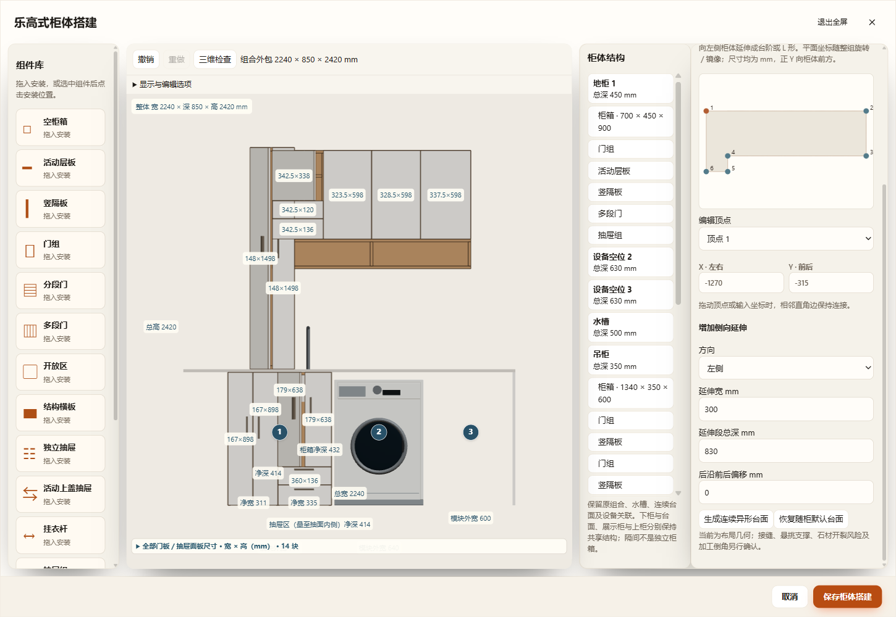

# 原有阳台地柜／吊柜的真实乐高组件编辑

2026-11-08。用户指出“同一种界面”必须包含原有地柜／吊柜的真实组件能力。此前版本只有新增独立柜箱走完整组件路径，本轮补齐原有实体柜；不是只换界面或继续通过旧模板操作层板。

## 实现

- 原地柜采用 `kitchen.modules[].structure={w,d,h,cabinet:v2}`，继续保留所在边、外宽、设备／水槽用途及安装关系；生产 `moduleFurniture()` 在组件分支直接返回乐高结构，不执行 `kitchenModuleConfig()` 或旧柜模板。
- 原吊柜、开放柜沿原分区键保存v2组件树和原有效宽深高，仍与连续台面、水槽和设备位组成同一家具。结构树直接列出原柜的层板、隔板、门、抽屉，组件库安装及属性修改调用 `B.add/update/remove/updateDrawer/updateLeaf`。
- 进入编辑器时转换可取消草稿；保存才应用。原开关状态、实际板件、门轴及行程先逐项比较，不能无损表达的异常／特殊旧配置明确拒绝，保留原数据，不静默降级为模板编辑。自动门数超过双扇或特殊旧抽屉前面板等超出当前转换范围的配置仍会明确拒绝；当前正式阳台已单独验证支持。
- `frontBand` 保留无门开放柜仍存在的前面板厚度空间；`backBottom` 保留无底地柜的原背板底标高。二者都是组件柜实体规则，覆盖生产板件、缓存和空间确认。新地柜嵌入结构及这些字段最低v80；导入、恢复边界正确识别组件类型，继续读取v1–v79。没有自动修改正式项目。

## 已通过

1. `test-laundry-existing-lego.cjs`：0／37／90° × 左右镜像共六组，转换前后整组世界板件完全一致；原地柜和吊柜分别实际增添、定位、删除层板／隔板／抽屉；保存当前／命名方案往返、三次恢复不漂移、v80仓库／缓存读取及严格非法字段拒绝。转换后屏蔽 `C.preset`，生产实体仍正常生成，证明没有继续执行旧地柜模板。
2. 当前正式桌面仅用 MCP 读取：1204×620mm阳台柜，转换前36块、转换后36块，逐块世界顶点完全一致；原地柜与吊柜均为v2。实际输入保留于忽略的 `.local`，仓库只归档[无位置／明细的只读结果](live-read-only-result.json)。未向正式桌面提交配置修改。
3. 三入口专项 `--assembly-only`：HTTP 49项、断网file 49项、同EXE隔离桌面50项。操作对象明确为 **原有** `base:0` 和 `upper`，并将 `C.editStructure` 替换为抛错函数；乐高层板增删／撤销／定位、隔板移动、门组和独立抽屉编辑、v80保存刷新均通过。原柜结构表单中没有旧模板层板列表／门型字段。见[逐项结果](three-entry-results.json)。
4. 最终补充桌面50项：直接修改原吊柜原门角；正式GLB对照额外纳入实际编辑后的原地柜与吊柜，187个生产网格逐件世界边界最大差0mm。见[结果](edited-original-export-results.json)。
5. 相关增量：组件柜144组生产组合、独立抽屉审计、旧柜升级72组扫掠、洗衣区原组合及缺角封板、工作区缓存、仓库版本兼容和file恢复通过；改动JS语法及差异检查通过。未运行全量检查。

三入口运行：`output/desktop-verification/cabinet-assembly-6sW20x`。最终编辑原柜／导出运行：`output/desktop-verification/cabinet-assembly-Ysk8T7`（含组件柜底板独立于旧无底标志及结构树长标签换行的最终修正）。均从固定方案快照复制，在独立源码／缓存／端口中执行，源快照保护通过；原正式文件和既有未提交工作区修改保留。

示意编辑没有写入用户方案。石英石加工、真实五金、承重及多设备自动关联仍沿上一阶段边界；未执行Blender重开，本次沿已有参数化生产构造及正式GLB逐网格检查。
