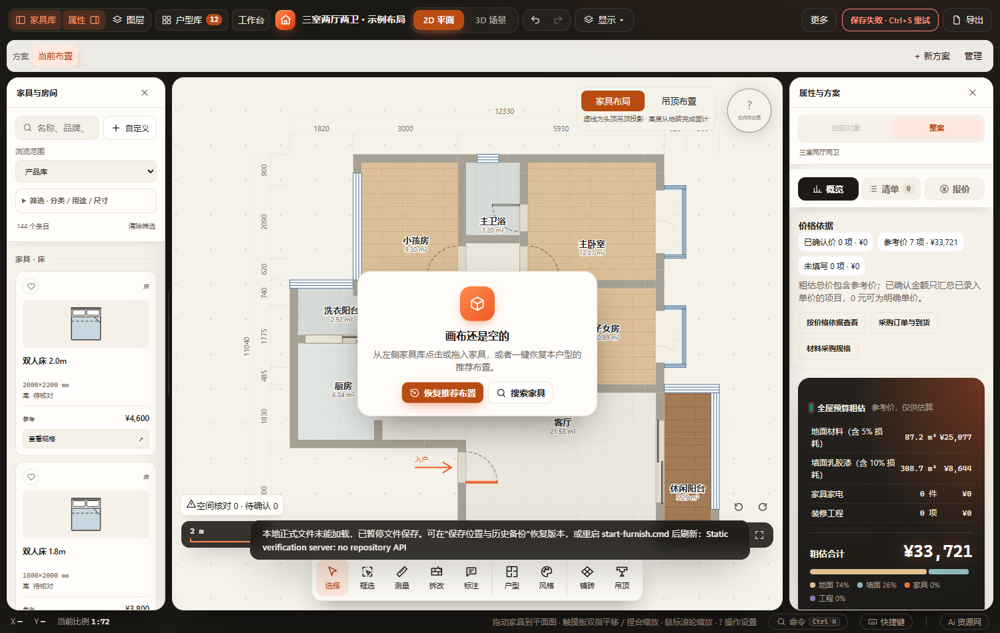
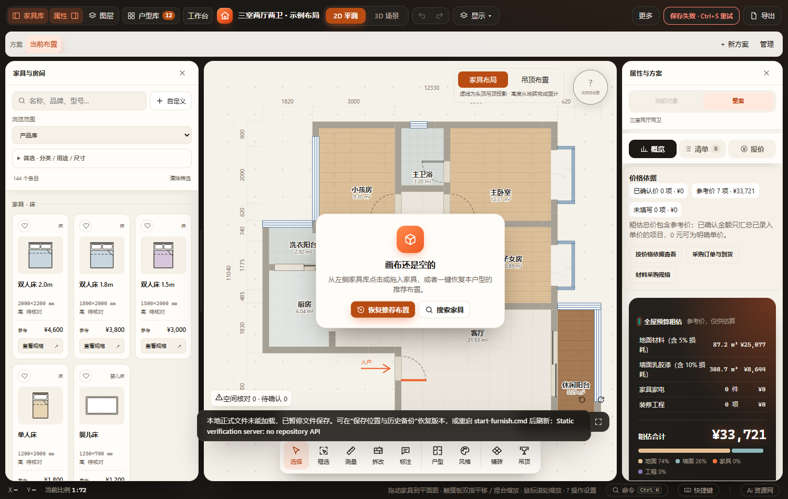

# 家具库随面板宽度重排（2026-11-02）

原网格固定两列，窄屏另固定三列，拖宽家具库只会拉伸卡片。现在统一按网格实际可用宽度使用 auto-fill，每列最小104 CSS px，保留9 px间隔；不足104 px时允许单列收窄，不撑出面板。默认248 px面板仍为两列，拖宽后逐级增加列数；auto-fill使不足一行的分类也保持同样列宽。尺寸均为界面像素，不是家具尺寸。未增加脚本、项目字段或保存通道。

已通过：`FURNISH_BROWSER_CHANNEL=msedge node scripts/verify-browser.cjs catalog-library`，HTTP与断网file两入口。新增断言覆盖同一窗口内拖宽后列数增加、缩回恢复；原用例覆盖键盘、取消、刷新宽度记忆、收藏、筛选、添加、撤销重做及390 px抽屉。实际检查宽面板与窄屏截图。结果：`output/playwright/verification-94Yyce/results.json`，截图位于该次隔离工作区的`output/playwright/catalog-library/`。

首次沙箱内Edge启动退出；经提升运行隔离副本通过。静态验收服务无正式保存API，截图中的保存失败提示来自隔离测试，不表示正式项目保存失败。未运行全量检查或本次正式桌面EXE目视验收。未修改正式方案；原工作区其它聊天的未提交修改保留。

