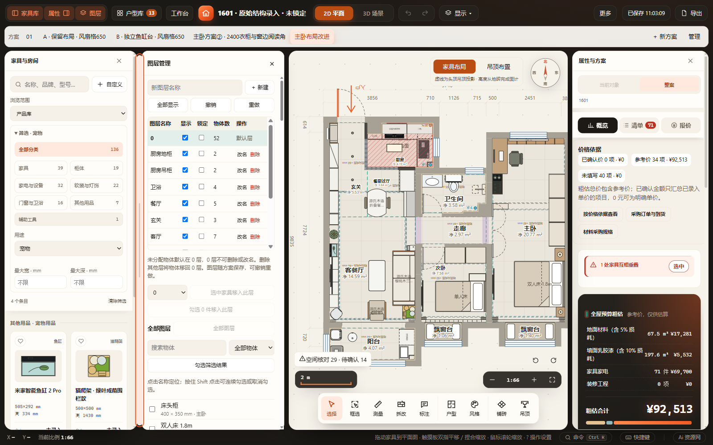

# 家具库宽度与筛选整理验收（2026-10-31）

家具库右侧增加可聚焦的拖动分隔条：拖动、左右键（10 px）、Shift+左右键（50 px）、Home/End；拖动中 Esc 或取消恢复上一次宽度，双击恢复默认 248 px。宽度在原 huxing-panes 本机偏好中保存，最高 640 px，按属性面板／图层开关及窗口可用空间收窄；不进入项目、撤销或空间核对。1100 px 及以下沿用抽屉、隐藏分隔条。

将产品库／本机收藏／我的家具／当前方案收为“浏览范围”下拉框。原分类、用途与尺寸组合匹配保持，用途移入统一筛选区；分类全选叫“全部分类”，折叠标题列出有效分类／用途／尺寸，避免多个“全部产品”与不易发现的隐藏条件。当前方案仍使用原管理器，替换期间仍禁用当前方案。

已通过：

- node --check：src/app.js、src/ui/catalog-ui.js、src/ui/workflow-tools.js。
- tests/test-catalog-navigation.cjs、tests/test-catalog-browsing.cjs：目录唯一性、身份与搜索、用途与尺寸阈值等。
- catalog-library、current-furniture：HTTP 和断网 file:// 两种入口；宽度拖动、键盘、Esc、双击、刷新记忆；收藏、自定义创建与删除来源、规格添加、拖放、撤销重做、当前方案管理、语言／深浅色、390 px 抽屉。
- furniture-replacement、laundry-catalog、product-naming、property-dedup：HTTP与断网file均通过，覆盖替换预览／确认、用途筛选、收藏来源与属性编辑调用方。
- 同一正式打包 EXE 的独立源码目录、缓存与端口；复制 D:/1601装修/Furnish项目/workspace.furnish.json 后验收图层并排、调宽、用途、当前方案，以及隔离布置的撤销重做／正式保存／刷新。源文件哈希保持一致。见 desktop-summary.json。
- 目视检查桌面截图和窄屏截图：范围入口、分类／用途／尺寸层级清楚，右侧图层与画布保持独立。

浏览器使用本机 Edge。默认 Playwright 浏览器未安装；沙箱内 Edge 启动即退出，经批准在沙箱外运行隔离验收通过。未运行全量检查；未修改或恢复正式装修方案，未替换桌面／浏览器正式缓存。

