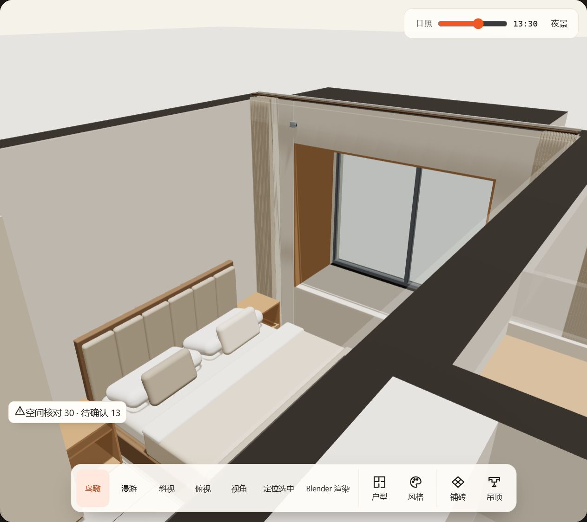
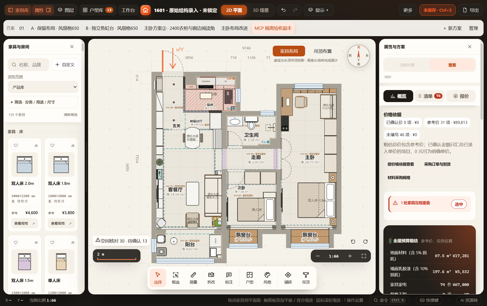

# MCP 设计及视觉接口验收 · 2026-10-31

工具由 4 个扩展为 11 个，接口及示例见 [MCP.md](../../MCP.md)。没有新增持久字段、项目版本、保存或撤销通道。

## 已通过

- `test-furnish-mcp`：真实 stdio 初始化、11 工具发现、JSON 参数与范围／枚举／危险键拒绝、HTTP 鉴权及来源拒绝、原生 MCP image 内容块、400 KB 参数跨 stdio/HTTP 传输、未启动桌面及退出清理。
- `test-furnish-mcp-desktop`：复制正式文件到独立工作目录／缓存／端口，以正式包 EXE 的逐字节相同副本加载本次桌面壳。库条目精确中心新增及幂等、完整洗衣区全部成员与关联、名称／配色／镜像／前方预留及产品安装／光源配置、完整柜门配置、null 删除覆盖、整批拒绝、原生撤销／重做、保存刷新、旧 revision、锁定、生产空间规则一致和 applied:true/persisted:false 冲突回执通过。
- 同 EXE 验证相机 whole/top、家具与房间聚焦、显式位姿、漫游和 FOV 实际读回；相机控制不增加项目编辑或撤销。真实二维／三维 PNG 经 MCP 返回，保存图片并实际看图核对。相关回执见 [results.json](results.json)。
- 同次隔离测试通过 HTTP 桌面入口及断网 `file://` 二维启动／三维加载与相机取景，没有页面异常。生产模型与相机仍为原主场景。
- 增量关联回归：product-rules、laundry-catalog、catalog-browsing、cabinet-door-settings、work-state、furniture-groups、drag-axis-lock、kitchen-auto-avoid、telescopic-20-placement；共享内联场景另验 scene-shadow-cache、scene-observation、electrical-box、recessed-bay-windows。改动脚本及 index 内联语法通过。
- 家具库测试原固定柜体条目数 12 已落后于当前目录 14，改为对照当前源目录的完整条目，保留唯一性及产品规格校验；该失败不是本次新增产品造成。
- 更新本机包 `resources/app/main.cjs` 前保留哈希命名备份到 `.local/desktop-shell-backups/20261031-mcp-design`。正式窗口再次读取为 saved/pending:false 后正常关闭重启，原正式文件 SHA-256 不变，当前方案及73件家具逐字段与该未改变的正式文件相同；原始 JSON 顺序哈希在恢复后不同，改用递归排序逐字段比较核实，无字段值差异。只读 get_camera/take_screenshot 在新主窗口成功，原生 PNG 为1263×1124，并实际查看。

## 未执行与边界

未跑 `scripts/check.cjs` 全量，不重新发布模型或运行 Blender 渲染；本次不改变模型几何。截图包含可见界面与选中叠层，不是干净离线渲染；取景由既有控制器约束，鸟瞰过近位姿拒绝，实际投影以读回为准。产品结构对象整体替换，调用者须保持原尺寸链，产品缺资料及空间算法未知项仍保留。正式装修方案仅只读核验，新增／配置／冲突测试全部位于隔离副本。

两个早期测试 fixture 问题（历史库名称未在当前库出现、只改单独板厚破坏宽度链）已纠正，均在隔离副本中失败且未影响正式文件；最终版本整链路通过。测试关闭清理对隔离窗口选择既有保留缓存分支，避免失败后等待保存确认。

Codex 已连接的旧 stdio 进程可能保留4工具清单，需重新加载 Furnish MCP 服务或开新聊天以发现全部11工具；无需改变用户 MCP 配置。
