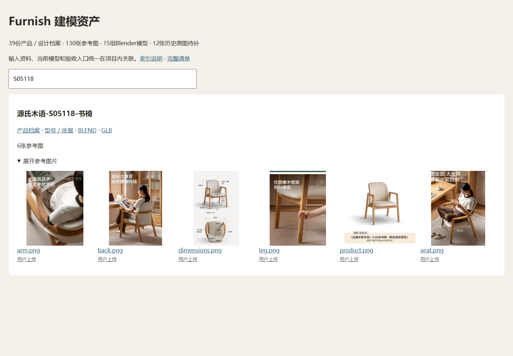

# 产品输入／输出目录整理验收

本轮只调整参考资料的存放、索引和导入工具，不调整产品构造、运行加载、持久数据或空间语义。基准提交037ca17，正式装修数据的既有未提交修改保留。

## 完成范围

- 39份`asset.json`产品／设计档案，130张图片及2份来源URL清单；12张历史图登记缺失。档案并不等同于39款已实现产品。
- 121张前轮D盘整理图收回项目，加上原模型目录已有的9张AVIF。97张既有项目图片迁移、33张此前未入库图片补入，原格式不改；D盘快照保留。
- 15组当前Blender源、运行资产、构造代码与型号文档统一关联，参数化配置／目录另列；历史版本及材质工程不搬动。
- 迁移映射见[migration.json](migration.json)。`legacyPaths`只是溯源，不是兼容加载路径；历史验收JSON保留原文，不把本次文件整理伪装成旧模型重验。

## 已通过

- `tests/test-model-assets.cjs`：39份档案及130图哈希、15个当前GLB来源、12份缺失依据、相对路径、确定性生成与`--check`；真实临时文件验证坏哈希、坏尺寸、缺文件、目录越界拒绝。隔离临时仓库验证导入、重复导入无变动、同名不同内容保留、非法类别拒绝。
- 与Git基准逐图比较：97张迁移图片字节一致，2份URL清单JSON内容一致（Git换行归一化与本机原文件换行可不同）。63份原BLEND／GLB／离线JS逐项哈希未变。
- 修改过的Markdown未新增断链；生成总览的237个本机链接均存在。HTTP与断网file分别检查39档案、130图片解码、S05118搜索及390px无横向溢出，零页面异常，见[browser.json](browser.json)。
- S05118、第一款亚麻色椅、柏林椅的生产几何／空间／项目回归通过；相关Node脚本语法及差异检查通过。
- 隔离空目录导出39份输入档案及其图片／来源清单，加原63份模型文件共234份文件，逐项哈希核对通过，源文件未变化。

## 未执行与边界

没有改动应用界面／加载或模型二进制，不重跑其余型号几何、全量项目检查、桌面EXE或GPU渲染。图像可打开与哈希一致不证明厂家尺寸／材质正确；适用依据继续以型号文档为准。输入图的分类与归属基于已有资料和上一轮目视整理，不推定未知型号，不把商品页补图冒充用户原始上传。

