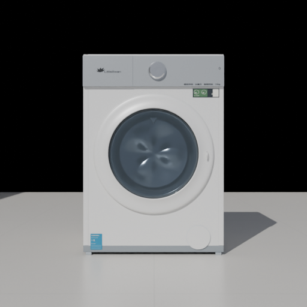
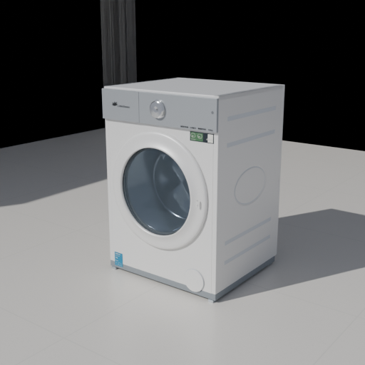
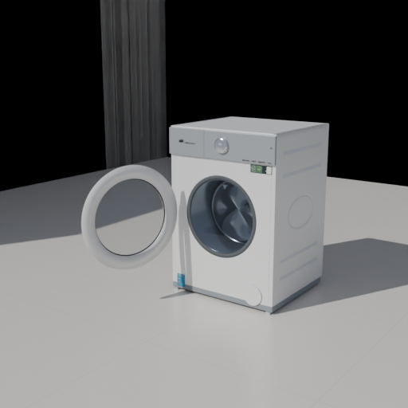

# 建模整链路工具验收

2026-10-30，Windows，Scoop Blender 5.2.3 LTS。执行入口及适用范围见[建模流程](../../BLENDER-MODELING-PIPELINE.md)。

## 自动验证

```powershell
node scripts/verify/verify-model-pipeline.cjs washer-tg10k60w gpu
```

最终运行的 [report.json](report.json) 记录代码基线、实际 Blender 路径、作者版本、阶段结果、重建资产哈希与源文件未改动检查。各阶段在隔离副本执行，正式资产及真实方案保持原样。大型源工程、GLB、下载工程与完整日志留在报告中的本机运行目录，不提交临时副本。

- 作者重建与预检；[七类真实故障注入](preflight-negative.json) 逐项拒绝。
- 独立发布、材质交换与生产几何，及尺寸／姿态、门轴／空角／中途障碍、测距／碰撞、旋转镜像、空间确认、v35往返专项。
- [HTTP与断网file应用验收](browser-summary.json)，含正式生产导出、撤销重做与刷新；[Scoop生产回读](production-readback.json)。
- 三机位经正式 API 实际 OptiX／RTX4070TiSUPER 渲染，PNG／BLEND／GLB下载；[重开三个下载工程](reopen.json) 检查47件身份、标称闭合尺寸、Alpha、相机和Cycles设置。
- CLI参数边界、Blender发现、合入主线相机校准单测、Python／JS语法与差异检查；旧通用洗衣机也实际通过新预检并导出15件源工程／GLB。

没有运行全量检查、其它产品的整链路配置或全屋性能基准。本次没有重新批准照片级还原、真实铰链限位或安装施工符合性。

## 固定图目视核对

[场景参数](studio.json) 固定正面、斜视和完整开门。检查模型完整入镜、门扇全开无裁切、面板／门圈分区、内筒、白色机壳与金属反射；仅作为当前生产几何／基础材质的可重复对照基线，玻璃仍为Alpha近似。没有用像素相等代替目视核对，也没有改写原精修模型。





## 开发中发现及处理

[首次失败报告](initial-failure-report.json) 表明固定机位驱动从工作副本启动时，触发了禁止测试当前仓库的保护检查；工具停止并记录 `studio-production-export`，之前阶段与源哈希状态均保留。驱动改为从外层检查隔离副本，保护机制保留。

随后目视发现基础灯光偏暗、隐藏吊顶投影及开门画面裁切；仅修正隔离夹具的照明、隐藏建筑导出及机位，最终从新目录完整重跑。运行中不覆写失败现场、不跳过失败阶段。
