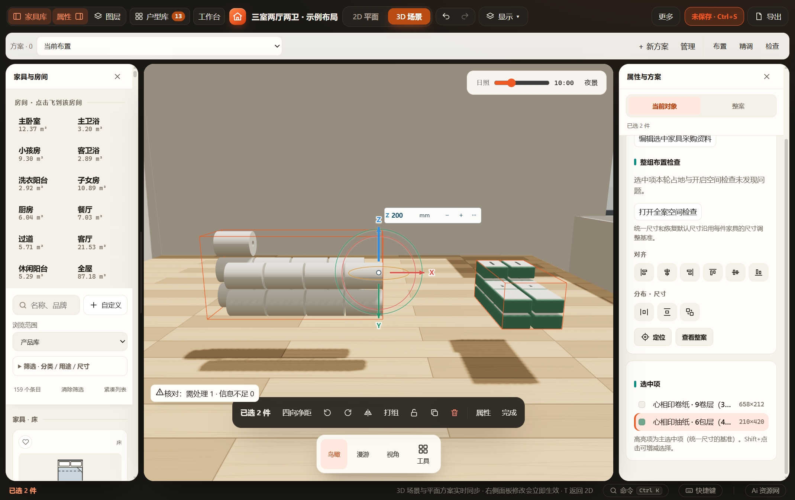
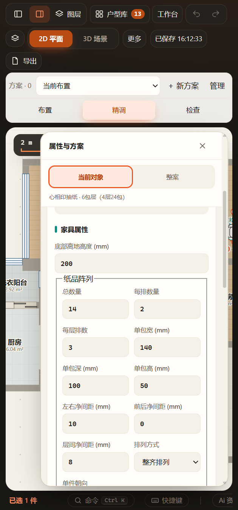

# 纸品阵列验收（2026-11-07）

范围和字段契约见 [PAPER-ARRAY](../../PAPER-ARRAY.md)。本次保留现有两个纸品类型及旧静态生产分支，新增可选阵列参数；未修改正式装修方案，已有 `projects/workspace.furnish.json` 未提交改动保留。

## 已通过

- `node tests/test-paper-array.cjs`：全部朝向／排列的真实Three单件尺寸与中心、末层不足、零间距、首次激活与旧层逐部件外包一致、200件上限及倾斜、数值实体、间隙碰撞、旋转镜像／高度分离、无关采购／配色保持确认、形状缓存与姿态缓存、复制／同型号／跨型号／库候选替换、非法参数、v62当前／命名／目录往返及重复恢复。
- 原 `storage-supplies`、`product-rules`、`product-pose`、`product-pose-production`、`replacement`、`furniture-replacement`、`repository-storage`、`recovery-storage`、`furnish-mcp` 定向回归；修改源模块与新测试语法检查。
- `node tests/test-paper-array-ui.cjs`：同一正式EXE、独立源码／文件／缓存／端口，验证单次撤销、重做、锁定和错误输入、保存刷新、窄屏、MCP完整对象与null恢复，实际3D与59个生产GLB部件逐一匹配；HTTP及阻断HTTP请求的file入口可编辑和显示。最终批次 `output/playwright/paper-array-J9WLgl/`，已复制[UI报告](ui-report.json)。
- `node tests/test-paper-array-blender.cjs output/playwright/paper-array-J9WLgl`：Scoop实际程序 Blender 5.2.3 LTS 将上述59件生产GLB逐ID／部件键回读，验证独立世界包络和对象材质槽，保存 `.blend` 后重开再次检查；最大世界包络误差0.00025mm以内。[回读报告](blender-readback.json)含程序路径、版本及GLB来源SHA256。原GLB、回读blend、脚本及日志保留在该批次目录。
- 已实际查看下列宽屏阵列场景和窄屏参数界面。示例分别为17卷（横放、隔排错位、三层且末层一卷）与14包抽纸（单件转90°、三排、三层且末层两包）。整体离地200mm为测试输入，不是正式方案。

成功UI批次的独立源码和桌面缓存已由测试目录管理器清理；截图、报告、导出与复制的测试项目保留。早期因测试控件定位、导出原点换算和浏览器隔离环境设置而中断的调试批次按测试约定保留，最终批次上述检查通过。

## 未执行及边界

未运行全量 `node scripts/check.cjs`，未重做原单件外观或替换原Blender发布资产，也未重新下载整套Blender渲染工程；本轮的源资产作者／独立发布阶段不适用，验证的是阵列生产导出及Blender回读。错位和横放不验证实物堆放稳定、柜体承重；卷纸中心孔沿原算法作保守碰撞处理。我的家具格式往返保留字段，本轮未扩展其仍以通用自定义条目为主的新增界面。正式桌面窗口仅通过MCP只读核对当前方案及保存位置，未强制刷新或清除原撤销栈。
