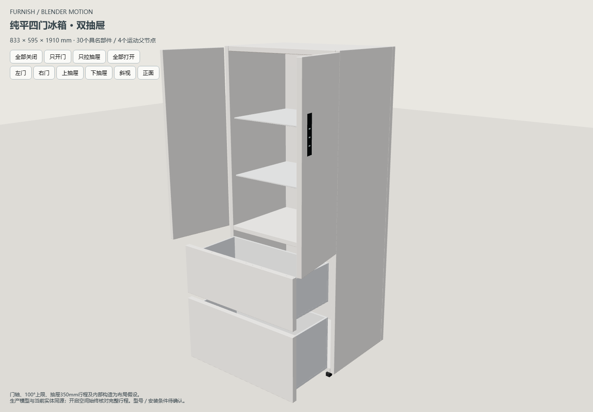

# 剩余九项回归修复与全量复验

2026-10-30，基于 `4b7206c`。按用户要求修复上一轮剩余失败并重新执行 `node scripts/check.cjs --keep-going`。**完整命令退出0：383／383回归通过、0失败；12个内置户型、99个预览页面、本地资源、共享声明及全部生产语法检查通过。** [机器结果](results.json) · [完整日志](check.log)。执行期间补充的生产门板90°端态与扫掠最大半径断言，也分别专项复验通过。

## 修复范围

| 回归 | 原因与处理 |
| --- | --- |
| 玄关共板 | 旧正面射线被合法打开的有限厚度门板遮住；改从柜侧验证原木板，完整门板扫掠仍包含闭合左边与打开末端。共板数量、厚度、闭合面、缺口及分离回归保留。 |
| 全目录吸附 | 2+0 联动门完整轨道超出名义门洞，旧矩形中心／固定端不适用；按真实轮廓放置，按生产轨道固定端框架检验拉伸。132目录条目、五种旋转及镜像，共2640次移动、2640次拉伸通过；曲线有限边检查保留。 |
| 两项烟机柜 | 前角门轴相对旧厚度中心轴横向差1 mm；更新门轴期望，闭合实际门面宽度／边界和烟道空腔实体检查保留。 |
| 厨房不等门宽 | 有限厚度扫掠的凸包首点不等于门轴；改用真实生产面板在0／30／60／90°的顶点包含检查，覆盖三种盖门方式和旋转镜像。实际宽度与2 mm接缝仍独立检查。 |
| 两项厨房拉伸 | 现有功能允许辅助线开启时对齐远处墙边；有限边负例显式关闭辅助线，原远距对齐专项仍验证开启行为。补齐选择渲染夹具的真实项目上下文。 |
| 布局几何 | 按实体ID区分上柜门与冰箱门，保留冰箱完整开门撞柜体的正例。另修复导出顶面坐标高0.0001 mm引起的机身假穿插；不改通用碰撞容差。 |
| 产品种类 | 柏林单椅加入“单人沙发椅”映射；不改实例名称／保存结构。 |

冰箱顶面只在本款源坐标高于名义顶面且误差≤0.00011 mm时还原，先还原再缩放和运动；源GLB及资产原文保留。1700／1910／2200 mm、四种旋转及镜像的等高接触通过，低0.01 mm顶板仍检出。含本款空间确认语义定向更新；价格／配色及无关产品不受此标记影响。

## 浏览器与目视

- [柜门宽度复验](browser-widths.json)：保存／取消、实际宽度、撤销重做、刷新、最小值、嵌套编辑、390px及真实项目下载／上传通过。首次失败是验收脚本未展开现有折叠属性组，改用共用设置展开辅助函数后重跑通过；没有强制点击隐藏控件。
- 墙边延长线专项通过；[初轮结果](browser-initial.json)保留这项通过及柜门脚本的原失败。
- [HTTP／file烟测](smoke-results.json)：两个入口均能加载完整应用，柏林分类正确，冰箱正式生产预览闭合／全开、390px及无页面脚本错误通过。真实Three顶面为1909.9999666 mm，处于Float32数值精度内。
- 已查看下列截图，冰箱开合与窄屏显示正常，未重做外观。不等门宽截图的450.25×798标签与门板分区已目视核对。

[离线窄屏](file-fridge-narrow.png) · [不等门宽正式预览](unequal-doors.png)

## 数据与限制

完整原始输出留在本机 `output/validation/fix-full-check-20261030/`，浏览器使用隔离副本与只读静态服务，不写正式文件。仓库 `projects/workspace.furnish.json` 和 D盘正式 `workspace.furnish.json` 的前后SHA-256完全一致，完整值见[机器结果](results.json)；原有未提交方案数据保留且不进入本次提交。此次未新建工作树或分支，仅有本地main；既有其他任务工作树保留。

本次没有重建或重新发布Blender资产、运行整屋渲染、实机触屏或施工验收。完整脚本不等于穷举全部独立浏览器任务或所有运动组合；开启扫掠的既有保守边界仍适用。
