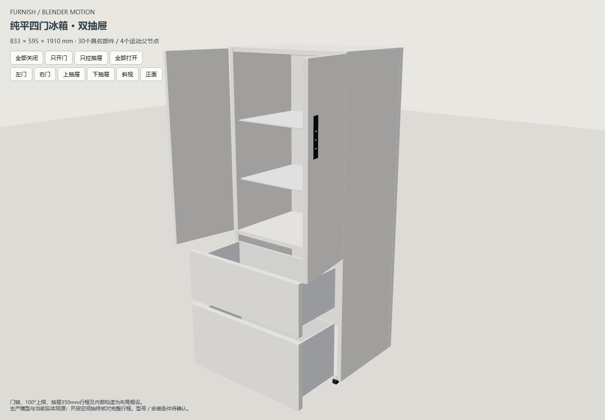

# 历史全量回归与复验

以下为 2026 年 10 月 24 日至 11 月 11 日的各轮历史结果。每轮结论对应当时的代码、输入与执行范围。日志、截图和机器结果沿用原目录。

- [2026-11-11 全量检查与缺陷修复](#2026-11-11-全量检查与缺陷修复)。534 套回归、160 项浏览器专项；保留首跑失败与逐项补验。
- [2026-10-31 全量检查与测试入口修复](#2026-10-31-全量检查与测试入口修复)。完整复跑通过 415 套回归；另有浏览器与桌面专项。
- [2026-10-30 修复后全量复验](#2026-10-30-修复后全量复验)。修复剩余九项，完整复跑通过 383 套回归。
- [2026-10-30 初查与失败项](#2026-10-30-初查与失败项)。保留修复前的失败和诊断，最终状态以上一节为准。
- [2026-10-27 主线及方案回归](#2026-10-27-主线及方案回归)。320 套回归、193 项有效浏览器专项及桌面、Blender 验收。
- [2026-10-25 主线及方案快照](#2026-10-25-主线及方案快照)。183 项浏览器专项及方案快照、Blender 同步验收。
- [2026-10-24 全量回归](#2026-10-24-全量回归)。284 组 Node 回归、167 项浏览器场景，以及生产预览与 Blender 验收。

## 2026-11-11 全量检查与缺陷修复

现有面板任务完成并推送 `2f9b9211` 后执行完整检查，修复后按实际影响复跑。当前534套回归和160个浏览器专项的有效结果全部通过；完整首跑的非零结果保留，不将补验表述为同一次命令零失败。逐项证据及最终生产源SHA256见[summary.json](full-regression-20261111/summary.json)。已有 `projects/workspace.furnish.json` 修改保留，不提交或覆盖。

| 范围 | 结果 |
| --- | --- |
| 当前回归套件 | 534套覆盖；完整运行533套，531套直接通过、2套修复后复验通过；另新增1套开启规则回归通过 |
| 浏览器专项 | 160项完整执行，137项直接通过、23项修复／更新现行夹具后逐项复验通过 |
| 内置方案、资源和语法 | 12方案；生产预览资源、共享经典脚本声明、全体脚本预检及225份改动脚本语法通过 |
| 实际D盘EXE隔离验收 | 13项通过，含保存／重启、390px、HTTP／断网file、打印、真实手柄位置的空格平移；正式原文件不变 |
| 实际stdio MCP与EXE | 15组流程通过，含幂等、独立设备物理对齐、原子失败／撤销、相机、保存冲突及原项目保护 |
| Blender | 5.2.3 LTS；HTTP／file各48件柜体生产GLB回读和保存重开通过；纸品阵列导出／Blender回归通过 |

### 已定位并修复

- 预览检查器将合法 `file:///…` 地址拼接为相对文件路径，且 `--keep-going` 遇单页资源错误仍退出。现在沿浏览器URL规则解析（含中文、空格、`#`、查询与片段），逐页记录错误继续执行；真实缺失资源与共享声明冲突仍失败。历史`output/playwright`／`desktop-verification`批次只消费自身验收结果，不将保留证据但已归档运行时的HTML当作发布预览。专项负例验证后续回归确实运行，默认快速退出保持。
- 旧柜物理profile改尺寸时保留板厚、却比例缩放中心：2400→2399mm后生产顶板到2399.00375mm，误报梁底接触。贴齐柜箱外沿且未独立改动的薄板改为固定外侧面；独立改动的板件保留自身参数。没有放宽碰撞阈值或改写正式设计。
- 捕获轮廓的铰链门曾生成额外“抽屉前操作空间”，使铰链竖管产生误报；该空间现在只用于抽屉，门板仍检查完整实际扫掠。派生签名`profileOpeningRule: drawer-passage-v1`使适用旧确认失效；普通组件柜、价格和配色保持原契约。
- 保留的损坏柜体中`columns`为字符串／空值时，版本识别和空间签名错误调用数组方法，阻断其它家具修复后的保存／显示。元数据只读取可识别的列，空间签名保留损坏原文；恢复、备份、独立修复及撤销重做通过，严格项目导入仍拒绝损坏结构，不补造可用几何。
- 桌面通用验收默认忽略本机EXE路径配置、只读仓库示例文件。现在共用桌面启动器发现路径，支持 `FURNISH_TEST_PROJECT`，保留隔离副本和原文件散列保护。
- 吊顶多选分支抢先处理Shift，阻止边／节点的自由拖动；无位移单击仍重建SVG，破坏浏览器双击目标。Shift在编辑手柄上保留自由拖动，在区域填充上保留取消多选；Ctrl加选保留。无位移抬起不重建边线，真实双击、拖动取消及多选合并分别复验。高度输入清空后跨区域切换保留空值，避免误显为0；仍阻止保存无效输入。
- 通用吸附只约束第一条斜向接触边，世界X/Y对齐可能使另一条垂直边留缝。保留首条接触并补解第二条垂直接触；沿原捕获范围，不放宽尺寸或碰撞规则。求有限轮廓支持值改为从合法尺寸归一化，不再临时构造1mm宽／深的参数产品。
- 原组合柜预览按名义外宽取景，移位的独立柜箱可落在画布外；现在正视取景与画布尺寸变化都读取组合核心的实际边界。水槽／灶具的橙色孔距先与绿色净距错侧，再按实际文字矩形预测避让位置；四向图纸旋转及390px不重叠。尺寸手柄绘制在净距文字上方，避免旋转后的窄／曲面产品被文字截获拉伸。家具库展开筛选时不再将整个长筛选块吸顶，并为滚动目标保留标题空间。选中聚焦按工具栏与画布菜单上方的可用高度取景，避免联动门拉伸手柄被底栏遮挡；四组收门方向／镜像的真实拖动与固定基点、工具栏位置分别通过HTTP和file复验。
- 三维按住空格后，选择手柄仍截获指针，无法平移相机；沿已有空格状态暂时隐藏该控件，松开恢复。浏览器HTTP／file及实际EXE从真实高度手柄位置拖动均通过，家具记录逐字不变。
- 面板和循环扇安装预留没有来源时显示待核对，不填造厂家要求。桌面夹具改用实际配置EXE；专用Electron生命周期夹具在正常完整性的临时运行时验证，不修改仓库ACL或关闭沙箱。需要GLB输入的纸品Blender回读可自动先运行其实际桌面导出，完整检查不再因缺少手工参数立即失败。
- 旧浏览器用例直接点击已移入“工具”的隐藏按钮，现统一沿菜单实际展开／点击。按用户要求移除88个旧浏览器脚本、3个旧编辑器手工脚本、1个多余键盘命令包装、11份旧UI夹具及旧CLI别名；160个现行专项显式登记。旧工作区及柜体／厨房转发API删除，调用直接进入组件搭建器；仍共用的背板／外观表单独立为`src/ui/cabinet-form-controls.js`。旧方案实体／安装／恢复保留，测试不再伪报执行旧编辑器；新建洗衣区按独立设备实际净空对齐验收，不恢复已取消的宿主链接。

### 已通过的专项

- 柜体外沿：162组高度／宽度／深度／旋转／镜像组合，另逐组恢复原尺寸；检查生产板件、独立离地、板厚、重复恢复、当前／命名项目往返及梁接触、1mm穿入、未知高度。原未编辑构造几何等价。现有132组尺寸回归及252组profile板厚回归通过。派生签名`profileBoundsRule: rigid-outer-faces-v1`限定捕获板件路线；普通组件柜、配色与采购编辑不改变签名。
- 开启与损坏记录：18组旋转／镜像／竖管位置和直径负例，门扇铰链切孔清楚、途中相撞与整板移除分别验证；13套相关核心复验通过。损坏列的字符串／空值／对象／空条目保留原文，正常项目导入校验不放宽。
- 通用吸附：176目录条目，五种旋转及镜像，3520次移动、3520次拉伸、10组曲面有限边接触通过；21套相关核心回归通过。
- 梁实体浏览器验收：HTTP与断网file，旧柜草稿取消、改高、梁高未知／接触／穿入、草稿核对、确认失效、保存撤销刷新及窄屏通过。导出的同一柜体各48件，Blender 5.2.3 LTS独立导入、材质槽、稳定身份、保存重开通过；GLB浮点顶高2399.00016785mm，未用其替代核心精确边界测试。
- 当前D盘正式文件的最终隔离桌面验收：160件方案副本，13项检查通过；证据`output/desktop-verification/verification-toDWUS/results.json`和`desktop-space-pan.png`。MCP证据`output/mcp-desktop-KZ5So3/results.json`。正式项目与仓库项目散列保护通过。

### 全量状态与边界

日志在`output/full-regression-20261111/`，初次失败、发布中临时快照、后续复跑分别保留。最终完整Node运行的两项失败分别为原生退出后的临时运行时句柄释放时序、MCP夹具仍要求旧洗衣宿主链接；修复后实际原生生命周期与15组MCP流程通过。浏览器23项首轮失败的每项补验证据列于`summary.json`，不隐藏失败日志。

浏览器／Electron经自动审批在沙箱外运行，编辑仅在私有副本。增量复验按影响更新隔离源或新建副本，不声称所有结果来自同一不可变快照；最终生产源哈希已归档。当前布局种子只保留相关布置、活动方案及户型，避免旧缓存迁移时无关历史副本耗尽localStorage；完整项目保存／恢复由核心和实际EXE文件副本覆盖。

本轮在主目录`main`汇总。已有方案JSON修改不进提交；本地仅`main`，无本轮临时分支。5个历史detached工作树含独有忽略资产和必要证据，其中`window-coverings`还保留未提交的方案JSON；全部继续保留；本轮不删除或覆盖它们。

空间告警不自动改动用户布局、补造厂家安装参数或标记已确认。文字避让是当前字号下的有限邻域显示布局，不替代实体碰撞计算。未做实体手机触屏、断电／OOM和全部Blender型号重建；本轮柜体与纸品Blender回读不代表重建全部家电资产。

## 2026-10-31 全量检查与测试入口修复

2026-10-31，用户明确要求执行全量检查并修复异常。本轮基线提交86115fa1；原有`projects/workspace.furnish.json`未提交修改保留，正式方案未编辑。

### 结果

- `node scripts/check.cjs --keep-going`复跑通过：**415个回归套件、12个内置户型、105个已生成预览页**，生产脚本／共享声明／本地资源检查通过，见[完整最终日志](full-check-20261031/final.log)。该入口的全量范围不等于全部GPU渲染或全部浏览器用例。
- 隔离浏览器：portable-smoke（HTTP与断网file）、cabinet-workspace、design-switching、furniture-replacement-3d、tv-image均通过，见[基础验收](full-check-20261031/browser-smoke.json)、[定向验收](full-check-20261031/browser-focused.json)及同目录逐项日志。
- 同一打包EXE的12项桌面验收通过：现有方案加载、沙箱、撤销重做／保存刷新、原生导出、导入、390px窄屏、生产WebGL、Blender状态接口、打印PDF、HTTP共享、断网file三维、退出重启恢复。所有编辑在独立工作目录和缓存副本中执行，零页面异常，见[桌面结果](full-check-20261031/desktop.json)。已目视检查隔离桌面三维截图。
- 资产索引`--check`、共享函数提取的参数默认值／缺失区段拒绝检查、最终文档链接与差异检查通过。
- 原工作区与检查前备份逐字节一致，SHA256为`9265a499a4389241b6594ce4cbac3563cc7237b52f0edd69e1102eaa3292ca6b`，见[结果汇总](full-check-20261031/report.json)。

### 首轮异常及修复

首轮边运行边定位，累计19个套件失败，见[首轮日志](full-check-20261031/initial.log)和汇总中的完整名单。复核表明，本轮失败来源是测试基座与已有生产接口／资料结构不一致；修复没有改动生产模型、应用交互、保存格式或用户数据。

| 原因 | 修复 |
|---|---|
| 多个测试按`function buildFurn(){`提取代码，实际函数已有默认参数 | 新增测试共用`production-source`区段提取器，按函数名定位并拒绝缺失区段；18个旧测试继续执行真实生产函数，原几何／缓存断言保留 |
| 旧VM环境未加载新加入的沙发床模型或真实材质工厂 | 共用fixture注入真实生产模型；烟机与冰箱用例使用正式材质机制，避免忽略clearcoat等物理参数 |
| 目录迁移后历史归档记录仍指向旧原图位置 | 文档检查覆盖产品档案，解码中文文件URL；历史路径沿产品清单找到唯一后继并验证哈希，不改写历史记录或忽略缺文件 |
| 柜体库固定写死10条，新增两款转角书柜后失效 | 检查应有产品类型及名称唯一性，保留模板、安装高度和项目往返断言 |
| 编辑器／场景fixture缺失后来增加的外围DOM、方案栏、保存核心或DPR状态 | 补充隔离环境依赖；目标行为仍由原断言检查，并以真实浏览器／桌面流程交叉复验 |

### 边界与保留项

未执行全部浏览器用例或93配置的Blender重建／发布／GPU整链路；没有生产模型变化，不把此次通过描述为重新验收全部外观。打印只验证PDF，没有调用物理打印机。

既有12张历史原图缺失记录仍保持待补；方案中的空间核对／待确认提示也不因软件测试通过而自动消除。本轮不移动家具、不把空间提醒改成通过，不宣称项目没有其它缺陷。

## 2026-10-30 修复后全量复验

2026-10-30，基于 `4b7206c`。按用户要求修复上一轮剩余失败并重新执行 `node scripts/check.cjs --keep-going`。**完整命令退出0：383／383回归通过、0失败；12个内置户型、99个预览页面、本地资源、共享声明及全部生产语法检查通过。** [机器结果](regression-fixes-20261030/results.json) · [完整日志](regression-fixes-20261030/check.log)。执行期间补充的生产门板90°端态与扫掠最大半径断言，也分别专项复验通过。

### 修复范围

| 回归 | 原因与处理 |
| --- | --- |
| 玄关共板 | 旧正面射线被合法打开的有限厚度门板遮住；改从柜侧验证原木板，完整门板扫掠仍包含闭合左边与打开末端。共板数量、厚度、闭合面、缺口及分离回归保留。 |
| 全目录吸附 | 2+0 联动门完整轨道超出名义门洞，旧矩形中心／固定端不适用；按真实轮廓放置，按生产轨道固定端框架检验拉伸。132目录条目、五种旋转及镜像，共2640次移动、2640次拉伸通过；曲线有限边检查保留。 |
| 两项烟机柜 | 前角门轴相对旧厚度中心轴横向差1 mm；更新门轴期望，闭合实际门面宽度／边界和烟道空腔实体检查保留。 |
| 厨房不等门宽 | 有限厚度扫掠的凸包首点不等于门轴；改用真实生产面板在0／30／60／90°的顶点包含检查，覆盖三种盖门方式和旋转镜像。实际宽度与2 mm接缝仍独立检查。 |
| 两项厨房拉伸 | 现有功能允许辅助线开启时对齐远处墙边；有限边负例显式关闭辅助线，原远距对齐专项仍验证开启行为。补齐选择渲染夹具的真实项目上下文。 |
| 布局几何 | 按实体ID区分上柜门与冰箱门，保留冰箱完整开门撞柜体的正例。另修复导出顶面坐标高0.0001 mm引起的机身假穿插；不改通用碰撞容差。 |
| 产品种类 | 柏林单椅加入“单人沙发椅”映射；不改实例名称／保存结构。 |

冰箱顶面只在本款源坐标高于名义顶面且误差≤0.00011 mm时还原，先还原再缩放和运动；源GLB及资产原文保留。1700／1910／2200 mm、四种旋转及镜像的等高接触通过，低0.01 mm顶板仍检出。含本款空间确认语义定向更新；价格／配色及无关产品不受此标记影响。

### 浏览器与目视

- [柜门宽度复验](regression-fixes-20261030/browser-widths.json)：保存／取消、实际宽度、撤销重做、刷新、最小值、嵌套编辑、390px及真实项目下载／上传通过。首次失败是验收脚本未展开现有折叠属性组，改用共用设置展开辅助函数后重跑通过；没有强制点击隐藏控件。
- 墙边延长线专项通过；[初轮结果](regression-fixes-20261030/browser-initial.json)保留这项通过及柜门脚本的原失败。
- [HTTP／file烟测](regression-fixes-20261030/smoke-results.json)：两个入口均能加载完整应用，柏林分类正确，冰箱正式生产预览闭合／全开、390px及无页面脚本错误通过。真实Three顶面为1909.9999666 mm，处于Float32数值精度内。
- 已查看下列截图，冰箱开合与窄屏显示正常，未重做外观。不等门宽截图的450.25×798标签与门板分区已目视核对。

[离线窄屏](regression-fixes-20261030/file-fridge-narrow.png) · [不等门宽正式预览](regression-fixes-20261030/unequal-doors.png)

### 数据与限制

完整原始输出留在本机 `output/validation/fix-full-check-20261030/`，浏览器使用隔离副本与只读静态服务，不写正式文件。仓库 `projects/workspace.furnish.json` 和 D盘正式 `workspace.furnish.json` 的前后SHA-256完全一致，完整值见[机器结果](regression-fixes-20261030/results.json)；原有未提交方案数据保留且不进入本次提交。此次未新建工作树或分支，仅有本地main；既有其他任务工作树保留。

本次没有重建或重新发布Blender资产、运行整屋渲染、实机触屏或施工验收。完整脚本不等于穷举全部独立浏览器任务或所有运动组合；开启扫掠的既有保守边界仍适用。

## 2026-10-30 初查与失败项

后续已对剩余九项逐一修复，最终状态与重新执行的完整检查见[修复复验记录](#2026-10-30-修复后全量复验)。下文保留本轮历史结果。

**结论：全量检查已完整执行，当前仍未通过。**

执行 `node scripts/check.cjs --keep-going`，以 `7121046` 为生产代码基线。首轮全部383个回归入口执行完毕，356通过、27失败，另有1项验收脚本语法失败，退出码1。首轮资源／共享声明／预览脚本及12个内置户型检查未报错。

本轮修复维护问题后，全部27个初始失败入口均做过复验；18个已通过，9个仍失败，语法失败也已修复并复验通过。与首轮未改动的356个通过项合计，当前已确认374／383通过。**修复后没有再次从头执行383个入口，不能把这些复验表述为全量命令退出成功。** [机器可读结果](full-check-20261030/results.json)记录首轮、复验及剩余项。

完整首轮日志、各失败入口复验日志及数据哈希保存在本机 `output/validation/full-check-20261030/`；不将大量生成日志作为仓库源码发布。

### 本轮已修复并验证

- 水槽吸附验收入口改为与其他浏览器函数一致的箭头函数表达式，可被独立语法检查和既有浏览器包装器解析；函数体不变。
- 鱼缸、占位体、窗帘、洗碗机、冰箱、镜像、管道包覆、电视、热水器及沙发夹具补齐实际生产入口所需的产品规则／单椅模块或DOM方法；仍调用真实生产构造器。
- 独立柜箱按两块完整侧板验证净宽与模块外宽，共享柜保留原隔板尺寸链；对应已发布的独立柜箱契约。
- 配色核对保留普通柜木色箱体／白门，分别限定Y52Y09成品木色及挂衣杆金属色，其他部件的未知配色仍失败。
- 完成面基准核对所有生产部件的最低点，保留纯地坪v10及含圆门洗衣机v35的独立格式断言；不再将任意第一块网格当作整机底面。
- 平面选中几何夹具提供真实项目核心与完整空户型；三维高度卡片提供已知房间基准、可追加子元素的DOM夹具，并核对高度数值。
- 冰箱预览核对现有专用 `fridge-model.js` 生产入口，其他预览保持各自真实构造器依赖；干净目录与仅引擎映射下的19页生成回归通过。
- 两份单椅文档改为引用可交付的预览生成器，避免链接到忽略的本机生成目录；文档链接回归通过。

这些改动限验收夹具、断言适用范围、文档与验收入口语法，没有修改生产几何、吸附规则、空间判定或用户方案。

### 仍未通过的9个回归

以下是待定位的回归差异，不能仅凭测试失败把它们全部判定为独立产品缺陷。保留原严格断言，未放宽空间容差或跳过用例。

| 回归 | 当前失败证据 |
| --- | --- |
| [玄关共板](../../tests/test-entry-shared-board.cjs) | 开门后射线未命中预期木板：`opening a door reveals wood` |
| [全目录家具吸附](../../tests/test-furniture-snapping-audit.cjs) | `telescopicdoor20`、0°未镜像移动场景，局部X偏移为10mm，期望0；已补充具体场景诊断 |
| [厨房模块烟机柜](../../tests/test-hood-bay-modules.cjs) | 门轴位置实际−484mm，期望−485mm |
| [独立烟机柜](../../tests/test-hood-bay.cjs) | 正式门板横向范围不满足现有断言 |
| [厨房门宽](../../tests/test-kitchen-door-widths.cjs) | 开启扫掠坐标实际6184.5mm，期望6202.5mm，差18mm |
| [厨房整边拉伸](../../tests/test-kitchen-outer-edges.cjs) | 远处有限墙段场景出现了本应没有的吸附引导 |
| [厨房分排手柄](../../tests/test-kitchen-run-handles.cjs) | 有限墙段不应按远处延长线吸附的断言失败 |
| [布局几何](../../tests/test-layout-geometry.cjs) | 合适冰箱上方柜门的开启障碍判定未满足预期 |
| [产品种类名称](../../tests/test-product-naming.cjs) | 柏林单椅 `armchair_yeswood_berlin` 的种类仍返回“未分类” |

优先继续核对开启实体／扫掠坐标及有限墙段吸附，然后明确各旧断言与当前模型契约的关系。此报告不证明相关实际布置已通过施工或安装验收。

### 数据与范围

开始与结束分别核对原仓库工作区和D盘正式文件，两者各自的SHA-256均未变化；原有未提交的仓库设计修改保留。自动保存、恢复、回执重试、文件迁移及桌面启动相关回归在首轮通过。

这是项目全量脚本及失败项复验，不包含所有独立浏览器验收任务、实机触屏、真实Blender整屋渲染或施工验证。修改脚本语法及 `git diff --check` 通过；其他对话工作树保留，本次未新建临时分支或工作树。

## 2026-10-27 主线及方案回归

基线 main 为 `2fe9bd0362bb4c838440363734874a4ce8cbe219`，开始时与 origin/main 一致，唯一未提交文件为装修方案。用户本轮要求完整回归、修复及分类推送，执行全量 Node、当前浏览器全集、实际 Windows 桌面版、真实 Blender 与四项性能脚本。验证中的 UI 编辑均在独立副本；原工作区固定 SHA256 为 `4d51d54afde47e4449c1fbea9ce7d83cbd5c3f49b93d7b350d6a4f3912cfa2e4`，全程未覆写。

### 本轮修复

| 优先级 | 原问题 | 处理与复验 |
| --- | --- | --- |
| P2 | 精修材质报告按 furnishObjectId 路径计数；生产结构新增 3 个网格后，57 个路径变化，实际材质保留却报告只有 4,468／4,525。 | 同一次合并内按实际保留对象及完整材质绑定统计，列出原有、匹配和删除数量；不会把删除对象算成材质损失。真正同步匹配与保护规则保持。 |
| P2 | 合并格式回归仍要求旧石膏自带光源结构完全不变，与明确升级为独立灯槽的规则冲突。旧缓存测试硬编码 v9，且未清除 v10–v25 的夹具缓存。 | 验证升级后几何／圆角参数、原输入不变、四次恢复无漂移、旧副本原样归档；缓存按实际需要的格式与独立键核对。 |
| P2 | 老吊顶浏览器用例依赖已移除的独立新建入口、组合石膏中的灯带或默认可见的边吊面板。铝扣板设备夹具也未先升级。 | `ceilings`、`ceiling-corners` 明确映射到当前创建／部件／升级／照明流程，旧脚本保留为历史记录；连续灯带与端板改验实际升级后的独立灯槽，复用页显式选择边吊，设备夹具先规范化。 |
| P2 | 厨房窄屏标签 SVG 容器的可见性判断使自动点击误失败。 | 验收先用真实屏幕矩形与 elementFromPoint 证实目标命中，再用实际鼠标点击；保留两侧输入、精确值、拖动、保存、撤销重做、镜像及窄屏断言，不使用强制点击或 DOM 直接派发。 |

旧独立入口的替代是跟随已提交的产品变化，不重新增加兼容入口；原 corners／continuous-light／end-caps 数值几何回归仍执行。初次失败和修复复跑分别留存，不将初跑描述为全通过。

### 验证结果

- [全量 Node](full-regression-main-20261027/node-final.log)：**320 套回归、12 个内置户型、69 个当前预览页面**，以及本地资源、共享声明、生产语法全部通过。初次仅 merged-format 失败，见 [原始记录](full-regression-main-20261027/node-initial.log)。末次浏览器夹具变更另做语法及实际专项复验。
- [浏览器最终汇总](full-regression-main-20261027/browser-final.json)：**193 个当前有效专项全部通过**。初轮 195 项中 8 项失败，修复并复跑 6 个有效项，另 2 个退休新建入口明确由当前流程接替；清单与原始失败、每项通过日志均保存。不会将退休入口重复算作额外通过项。
- [实际保存方案](full-regression-main-20261027/saved-workspace.json)：v25、65 件家具、4,528 个有限生产网格，HTTP／断网 file://、窄屏、刷新无漂移和 v3 GLB 发布均通过。[三维截图](full-regression-main-20261027/saved-3d.png)已目视检查。
- [真实桌面 EXE](full-regression-main-20261027/desktop.json)：12 项检查通过，包括已有方案恢复、沙箱渲染器、编辑／撤销重做／文件保存刷新、原生下载、文件导入、390px、WebGL、打印 PDF、HTTP 共享、断网 file://、退出自启服务停止和重启恢复。已检查[窄屏](full-regression-main-20261027/desktop-narrow.png)；源方案散列保持。
- [真实 Blender 事务](full-regression-main-20261027/transaction.json)：八个失败注入阶段完整回滚；等数量互换、独立材质、锁定姿态、共享网格、数量／版本保护通过。新增统计回归覆盖路径互换、正常删除和真实材质替换能被发现。
- [持续同步](full-regression-main-20261027/live-sync.json)：真实浏览器发布器、安装 ZIP 接收器及 HTTP 回执通过，版本仍为 0.1.4／protocol 3；本次仅修复精修 worker 统计，无需插件协议升级。
- [当前方案客厅精修](full-regression-main-20261027/refined-living.json)：旧 4,525 个对象全部匹配且材质保留，新增 3 个，无删除；原世界、客厅机位和 8 盏灯保持。实际 RTX 4070 Ti SUPER／OPTIX 960×720 预览已[目视检查](full-regression-main-20261027/refined-living.png)。对修复前渲染副本的独立逐项比较也证实共有材质无变化，见 [material-diff](full-regression-main-20261027/material-diff.json)。不是实际材质丢失后的修补。
- 已将完整 4,528 网格场景保存到 `D:/1601装修/渲染/全量回归-20261027/1601-当前方案精修副本.blend`，[本机登记](full-regression-main-20261027/blender-binding.json)由 v1 原工程改指此副本；旧登记有[备份](full-regression-main-20261027/blender-binding-before.json)。原工程和上一轮副本保留；[重新打开登记副本的自由视角渲染](full-regression-main-20261027/refined-source-camera.json)通过：4,528 个部件绑定全部保留、8 盏灯保持、源副本散列不变；实际 OPTIX 951×960 [俯视预览](full-regression-main-20261027/refined-source-camera.png)已目视检查。
- [四项性能脚本](full-regression-main-20261027/performance-status.json)均完成并通过数值一致性检查：平移均值约 6–8 ms，renderAll 约 245–251 ms，数值编辑约 0.73–0.97 秒，拖动更新约 47–51 Hz。测量时有并行回归负载，不作跨轮严格加速比较；完成脚本不等于达到稳定 60Hz。

### 装修方案与已知边界

[方案差异](full-regression-main-20261027/scheme-diff.json)：相比仓库原 61 件，本轮保存 65 件，新增强电箱、弱电箱、两组三联动门，10 件既有家具参数有变化，包含 5 个吊顶区域及相关图层／观察状态。代码与数据分别提交，不替用户重布置。

当前生产规则返回 **46 条空间提示：34 条非 pending、12 条待确认**，原始列表见 [空间核对](full-regression-main-20261027/spatial-issues.json)，与实际主界面计数一致。包括 7 条吊顶相关、门／抽屉开启、柜前操作、管道／墙界和狭窄候选间隙；并非 46 个已确认施工缺陷。未知楼面／洞口高度和安装条件继续待核对，自动切孔提示也包含在列表中，未通过改摆放或隐去核对项消除它们。

- P1 后续：逐项人工核对真实空间与安装资料；复杂精修拓扑、分片不同材质／锁／修改器仍不能自动推断继承意图。本轮当前方案正常同步，并未放宽原保护。
- P2 后续：大方案数值编辑仍有可感知等待，拖动未稳定 60Hz；未细化小孔／倒角、未知实体与倾斜运动板件仍有保守近似。
- 未执行：其他操作系统／Blender 版本、物理手机触屏、物理打印机、强杀／断电／OOM、四区最终高质量出图、签名安装器与自动更新。桌面版是本轮现有 Windows x64 实包验收，不代表全部平台已支持。

大型工程与 GLB 保留在本机输出和装修目录，不加入 Git。旧附加工作树含唯一历史产物且仍为此聊天附件，保留；本轮没有创建新分支或工作树。

## 2026-10-25 主线及方案快照

基线 main：`368e593`。按用户明确要求执行全量检查；代码侧验证完成。用户在验收期间继续编辑方案，并选择“等我编辑完成，再验收并提交最新方案”，因此本轮只提交代码、用例和记录。`projects/workspace.furnish.json` 保持用户编辑状态，最终整案验收、方案提交和主精修绑定更新待其编辑完成。以下 66／65 件均为冻结快照，不代表当前正在编辑文件的最终结论。

### 修复与影响

| 优先级 | 问题与修复 | 实际证据 |
| --- | --- | --- |
| P1 | DL269 七个网格仍输出旧身份版本，混入 v3 场景会被 Live Sync 拒绝；补齐固定语义身份，尺寸变化和顺序调整保持匹配。 | [修复前失败](full-regression-main-20261025/downlight-identity-before.log)、生产模型身份回归 |
| P1 | 电箱切孔使同一墙体由 BoxGeometry 变为 BufferGeometry，旧接收器误用源材质覆盖精修材质。0.1.4 对同作用域同 v3 身份且槽数兼容的对象保留绑定；旧版、重复身份和数量保护保持。 | [修复前失败](full-regression-main-20261025/geometry-class-before.log)、[真实 Blender 事务](full-regression-main-20261025/transaction-014.json) |
| P2 | 同一家具被多个板件命中时反复列名，最长提示 6,569 字符；按家具 ID 汇总后最长 56 字符。不同同名家具仍分别保留。 | [修复前重复](full-regression-main-20261025/obstacles-before.log)、[原 66 件结果](full-regression-main-20261025/current-spatial-issues.json)、[修复后](full-regression-main-20261025/current-spatial-after.json) |
| P2 | 相同文案的独立门扇被结果去重合并；去重纳入开启位置。原 38 项保留并补回一条餐厅下柜门扇提示，共 39 项；没有修改碰撞几何来消除提示。 | [修复前漏项](full-regression-main-20261025/distinct-sweeps-before.log)、test-cabinet-obstacle-messages |
| P2 | 筒灯缺失安装资料的核对能力未登记；统一标记待核对，不推定厂家要求。遗留热水器／餐边柜和分水器厨房预览缺共享身份依赖，补齐加载顺序。 | 产品规则及实际生产预览浏览器回归 |
| P2 | 全量夹具落后于生产：VM 未加载筒灯、把现已支持版本当非法、浮动窗口异步应用后立即断言、预览写入非隔离目录。修复夹具、等待动作结束并统一隔离输出；历史几何记录不再被测试改写。 | [全量 Node](full-regression-main-20261025/node-014-final.log)、[浏览器汇总](full-regression-main-20261025/browser-final.json) |

### 已通过

- 全量 `node scripts/check.cjs --keep-going`：309 套回归、12 个内置户型、69 个当前预览页面，以及生产语法／本地资源／共享声明。
- 183 个注册浏览器专项全部有通过结果；三组初跑后对失败项修复并复跑，额外加强餐边柜预览。汇总保留初跑失败与最终通过来源，不把初跑称为全通过。相关流程覆盖 HTTP 与断网 file://、实际生产模型、保存／撤销重做／刷新、项目往返及适用窄屏；逐专项模式以原测试为准。
- [65 件快照](full-regression-main-20261025/saved-65.json)：HTTP／file 恢复 4,525 个有限生产网格，全部 v3，刷新无漂移、390px、GLB 发布通过；[66 件快照](full-regression-main-20261025/saved-66.json)也通过。静态只读服务器不提供仓库写 API，窄屏图中的提示为预期隔离行为。已目视检查 [65 件三维](full-regression-main-20261025/snapshot-65-3d.png)和[窄屏](full-regression-main-20261025/snapshot-65-mobile.png)。
- [0.1.4 实际 UI／HTTP／安装 ZIP 连续同步](full-regression-main-20261025/live-sync-014.json)通过；[真实事务](full-regression-main-20261025/transaction-014.json)覆盖八个异常注入阶段回滚、等数量互换、独立材质、锁姿态、删除恢复、重复／数量／旧版保护。测试不是仅 mock bpy。
- [本机安装](full-regression-main-20261025/installation-014.json)及[独立进程加载](full-regression-main-20261025/installed-load-014.json)确认 0.1.4；旧插件和用户偏好有备份，既有 Blender 窗口未强制重载或保存。
- [65 件精修副本](full-regression-main-20261025/reviewed-refinement-latest.result.json)：原 4,355 网格转为 4,525，4,351 个共有对象材质全部保持，新增 174、移除 4，9 个锁定姿态、8 盏灯保持；贴图打包、保存重开、原文件散列不变。一个已确认统一材质墙面由 2 片变 4 片，使用固定源／输入散列及精确清单的显式迁移工具；[六类拒绝边界](full-regression-main-20261025/reviewed-guards.json)通过。不同材质／锁／修改器的墙片仍拒绝猜测继承。
- [65 件实际精修 UI 渲染](full-regression-main-20261025/refined-ui-65.json)通过：使用原客厅机位、世界与 8 盏灯，全部 4,525 个绑定保留，OPTIX 960×720／32 samples；面板关闭重开及窄屏通过，原副本与冻结方案散列不变。已目视检查[客厅预览](full-regression-main-20261025/refined-living-65.png)，不作为四区最终出图。
- [66 件 GPU 基础渲染](full-regression-main-20261025/gpu-66.json)实际使用 RTX 4070 Ti SUPER／OPTIX，PNG／BLEND／GLB 下载通过。默认鸟瞰受吊顶遮挡，这是导入与 GPU 流程验收，不作为室内最终精修画质验收。
- 66 件隔离快照的平移、拖动、帧跟踪、数值编辑四项性能脚本均成功完成，日志单独存档；脚本完成不等于满足 60Hz 性能目标。

### 未解决与下一优先级

1. **P1：最终方案尚未验收。** 用户正在编辑；原 66 件快照有柜体与吊顶、门／抽屉扫掠、燃气管／墙界、狭窄通道等空间提示，以及 12 项高度／安装条件待核对。不能把模型告警直接认定为施工缺陷，也不能自动改动用户设计。最终版本须重新计算，旧数量不作为当前方案结论。
2. **P1：复杂精修结构变化需要人工确认。** 旧 v1 工程安全拒绝升级，旧 v3 副本遇墙片数量变化也安全拒绝；本次仅对已确认统一饰面生成独立迁移副本。任意拓扑重写、不同分片材质、锁姿态或修改器不自动迁移；主工程与登记未覆盖。
3. **P2：大方案交互仍有等待。** 66 件快照数值编辑平均约 1.62–1.65 秒，全量 renderAll 约 648–652 ms，拖动更新约 34 Hz，未达到 60Hz；平移约 4–9 ms。此次保持同步核对与数值结果一致，未做新的性能架构改造。见 performance-*.log。
4. **P2：既有算法与资料边界。** 未登记细化实体的形状及小孔／倒角仍可能保守近似，两个倾斜运动板件使用高度裁剪投影；安装高度与厂家净空未知时继续待核对。未批量推定空腔或安装要求。

### 未执行

未做强杀／断电／OOM 恢复、其他系统或 Blender 版本、实体手机触屏、四个区域最终高质量精修出图；当前用户编辑中方案的最终性能／空间验收和数据提交也未执行。真实失败回滚结果指本轮列出的八个受控注入阶段。

原精修工程、旧稳定身份精修副本和当前装修数据均保留。旧工作树内仍有唯一历史验证产物，本轮不清理其文件。机器路径、散列及冻结输入清单保存在 JSON；大型 GLB／BLEND 留本机验证目录，不加入仓库。

## 2026-10-24 全量回归

284 组 Node、12 套内置方案、46 个预览通过。执行初始全部 163 个规范浏览器场景，新增加 4 个并纳入规范入口；失败项及受影响链路复验后，最终 167 个场景均有通过记录。保留初始失败日志，不把首轮结果写成全部通过。完整清单见 [浏览器结果](full-regression-20261024/browser-final-results.json)。

实际修复：P1 自动检修盖板对损坏分区字符串／空成员的扫描会阻塞恢复与事务；P2 新设备缺少安装资料待核对能力；P3 分水器帮助仍显示旧默认高900 mm。另同步 VM 依赖、稳定浏览器抓取／抽屉等待，并修复专用预览不遵守隔离根目录的问题。未放宽尺寸、空间、拖动精度或面积断言。

Blender 连续发布／ZIP接收、八阶段异常回滚、当前精修工程活动机位及 Furnish 当前相机分别通过；OptiX 出图。4355 个网格材质绑定和8盏灯保留，源工程／装修数据哈希未变。两张 PNG 供查看，不重做历史四区域正式成片。

本地9份工作区、1份命名方案（383／43件家具）严格校验并三次往返无漂移；JSON与本轮开始时main已有对象相同（c045c62b15e55e3fd321410f7df990c03a9f8fdf），因此没有创建空的数据提交。

主要边界：电箱仅轴对齐自动贴墙、裁切无新增槽口封边；分水器为照片近似与包络让空，无厂家操作距离；微孔／曲面和未记录家具仍有保守碰撞；Blender单向全快照、歧义部件匹配及强退恢复有边界。未执行实机触屏、其他系统或Blender版本、进程崩溃／OOM恢复、施工／水力／电气验算。

原始命令、各项证据和截图见 [结果汇总](full-regression-20261024/summary.json) 及同目录文件。新功能原增量记录位于各模型文档链接，保留当时范围。
