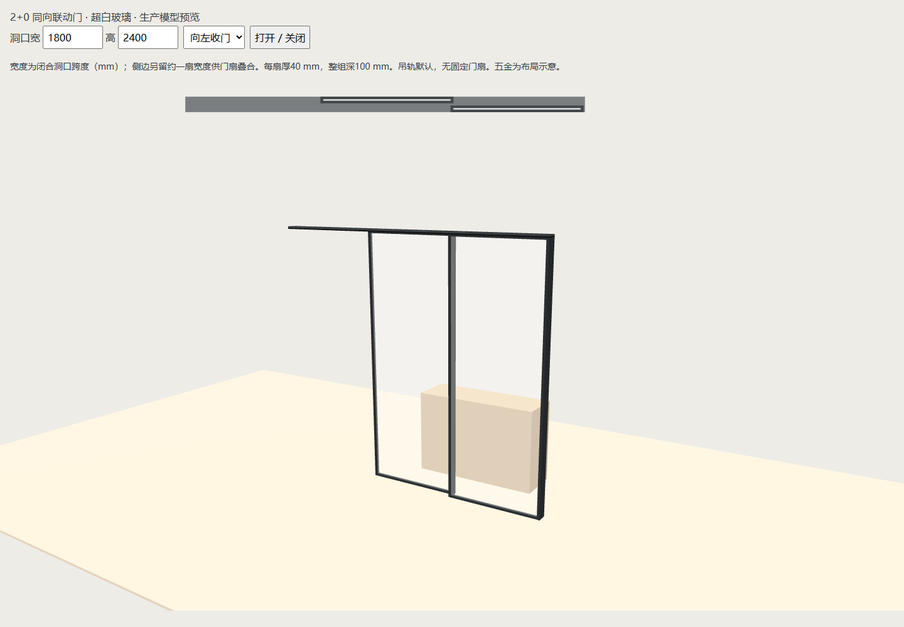
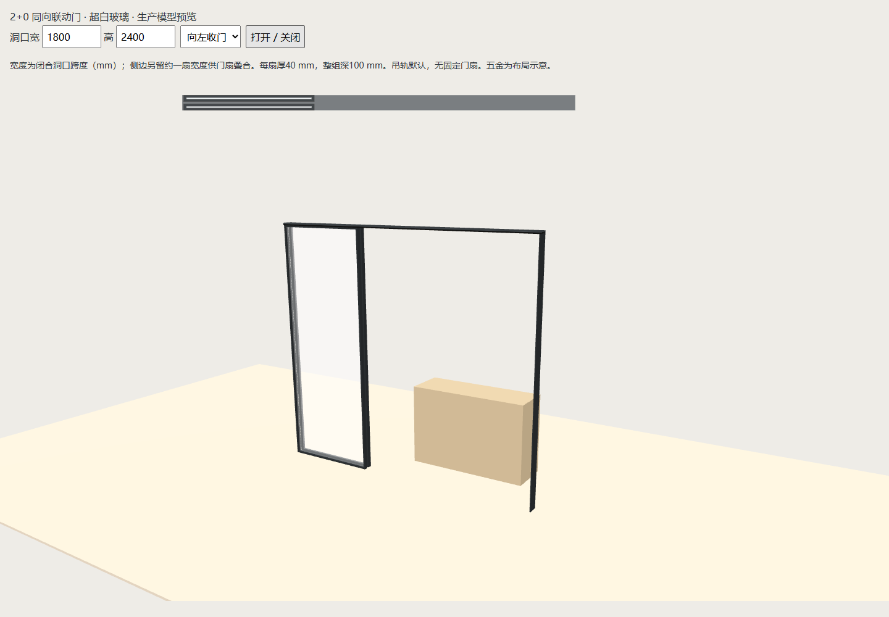

# 2+0厚度及推拉移门玻璃验收（2026-10-28）

用户指定单扇厚40 mm、新建整组默认深100 mm；所有推拉移门为超白玻璃。参数及旧实例契约见 [联动门](../../TELESCOPIC-OPENINGS.md)。

已通过：

- `test-sliding-door-glass.cjs`：生产Three单扇外包含拉手40 mm，整组外包与设定深度一致；80／90／100／150 mm两条轨道无穿插，低于80 mm拒绝、等于80 mm面接触；二维40 mm轮廓、所有家具移门和建筑入口超白玻璃；旧深度重复恢复无漂移、项目／命名方案往返与确认失效。
- 相关Node增量回归：test-telescopic-20、test-telescopic-20-placement、test-telescopic-floor-tracks、test-telescopic-corners、test-product-rules、test-curtains-sliding、test-enclosed-boundary-distances、test-project-validation、test-work-state、test-furniture-solids-coverage（均为tests中的.cjs）。
- 改动普通脚本语法与主页面共享声明检查。
- 隔离Edge HTTP／断网file://：100 mm新建、改深120 mm及撤销回100、固定基点、真实鼠标左右／镜像拖动、开合／复制／撤销重做、缓存刷新、主场景各类推拉移门材质、390 px；无pageerror。见 [browser-results.json](browser-results.json)。命令：设置 `FURNISH_BROWSER_CHANNEL=msedge`、`FURNISH_TELESCOPIC_VERIFY_NAME=sliding-glass-20261028`，运行 `node scripts/verify/verify-telescopic20.cjs`。
- 目视核对生产预览的关闭／左右叠合、40 mm二维条带及窄屏。

首轮新专项夹具缺少名称／颜色，恢复按既有规则补齐而导致断言失败，完善夹具后通过；首次新增浏览器材质断言遍历了子组已被主场景接走的空容器，改为遍历实际slidingDoor.group后HTTP／file均通过。

本轮为增量检查，未运行全量check.cjs、实机触屏、Blender同步／渲染或厂家安装验证。100 mm来自用户本次案例选择，不推广为所有厂家要求。80 mm仅为两个40 mm实体不穿插的数值边界，不是施工建议。已有工作区两条2+0记录的90 mm深度原样保留，本轮不修改或提交用户方案文件。
