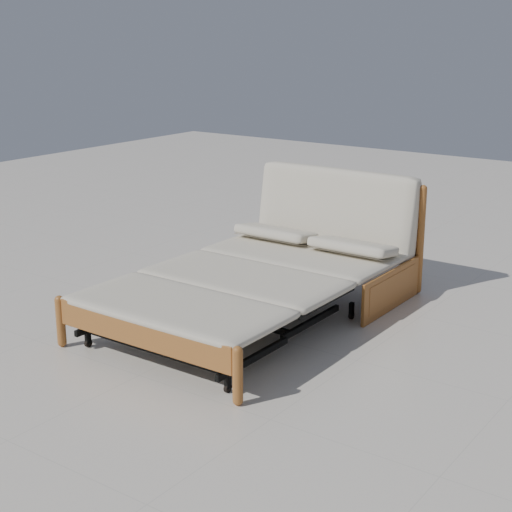
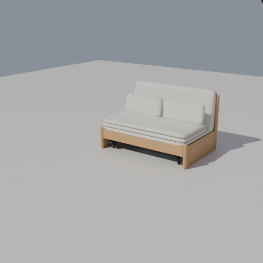

# Y107H03沙发床 · 展开与切换增量验收

2026-10-31。当前资产为v3制作目录、运行身份 `sofa-bed-yeswood-y107h03@2`，79件／6个运动父节点，实际Scoop Blender5.2.3 LTS。收起838 mm、展开模型占深约2018 mm；展开值是按商品图片推算，非厂家尺寸。推算、字段和算法边界见[型号契约](../../SOFA-BED-YESWOOD-Y107H03.md)。

## 已通过

- 新源工程作者预检、独立GLB发布；9类负例拒绝，包括错误轴向、闭合外观不变的错误轴心及部件脱离随动。嵌套前折垫轴跟随中折垫，具名身份与所属角色一致。
- 真实Three生产几何及数值实体：收起1250×838×770 mm／坐高400，展开1250×2018×770 mm／床面模型高300；两折垫铺平至250–300 mm、中架／前架前移590／1180 mm。非等比宽深高先拟合再刚性翻转；后框、侧板、靠背和固定垫保持原位，角色数量非空。
- 两种状态、0/37/90°旋转和镜像、外部间隔、接触／0.1 mm穿入、完整包含、未知高度和高度分离、吸附、79件当前实体、保守展开操作区。两端态都不碰的高处障碍仍触发操作区提示；高于操作区的障碍排除。不是连续机构自碰撞或厂家安装结论。
- v40新建默认、旧缺失不补写、非法值拒绝、跨类型替换清理、项目／命名方案、仓库和缓存历史读取、恢复三次不漂移。本型号状态／新几何使旧确认失效，价格／配色保持。
- HTTP与断网`file://`的生产模型尺寸编辑、撤销／重做、刷新和窄屏，以及两端态正式GLB导出／真实Blender逐部件回读。79件几何、身份、材质与世界边界一致。
- 实际控件收起→展开→撤销→重做→刷新→收起→展开，锁定阻止编辑；每次公开生产GLB导出的79件世界边界逐件与当前目标实体配对，防止缓存或旧端态冒充正确状态。
- 正式渲染API的正面、斜视、展开三个GPU机位及下载工程重开。重建私有副本和正式运行资产的全部发布字段逐项相同，只有源GLB容器哈希不同；两个来源哈希独立保留，不改写为相同哈希。
- 同一正式打包EXE复制当前正式文件到独立目录／端口／缓存，实际形态控件、尺寸及形态撤销重做、展开状态保存刷新、两态三维显示通过，真实文件哈希不变。末次截图后显式保存，正常关闭隔离EXE。
- HTTP／离线预览的收起与展开在390／1440 px下完整取景。最初固定机位会裁掉窄屏展开床头，现按实际生产包络球与宽高比适配，八个包络角点投影全部位于画面内，并作目视核对。

相关增量回归通过：`product-rules`、`furniture-svg`、`catalog-navigation`、`furniture-replacement`、`project`、`project-validation`、`project-recovery`、`work-state`、`workspace-cache`、`repository-workspace`、`repository-storage`、`repository-startup-validation`、`repository-save-retry`、`side-table`、`dishwasher-project-v32`、`washer-project-v35`及本款两套测试。`repository-storage`首次仅被沙箱回环权限阻止，获准在本机复跑后通过。

## 目视结果

已对照商品三种形态、翻垫和裸架图：三段垫面、保持竖立的靠背、随底架前移的前栏／支腿、中段黑架和平放腰枕可见。材质、软垫与框体交接和隐藏五金为近似，自动通过不代表照片级或制造级还原。

窄屏见[完整展开预览](preview-open-390.png)，实际EXE见[展开](desktop-open.png)／[收起](desktop-closed.png)。首次桌面取景被测试房间墙体遮挡，最终在副本中将展示件放到户型外并重新定位取图；截图中的“户型外／完成面标高未知”是该展示位置的预期提醒，不作为布置核对通过结论。

## 记录与边界

[阶段报告](report.json)、[批次](batch.json)、[预检负例](preflight-negative.json)、[空间](spatial.json)、[生产导出](production.json)、[逐部件回读](readback.json)、[渲染配置](studio.json)、[下载工程重开](reopen.json)、[真实控件与缓存](toggle.json)、[取景复验](preview.json)、[桌面](desktop.json)、[正式来源哈希](source-hashes.json)、[重建几何等价核对](rebuilt-equivalence.json)。原始批次 `output/model-pipeline/selection-KjfV1i/`，桌面 `output/sofa-bed-desktop-GjLdsj/`，控件／预览 `output/sofa-bed-toggle-final-20261031/`。

未运行全量检查或其余91项模型流水线，未验证实物展开总长、真实连续机构、自碰撞全过程、软包压缩、承重或施工。只提供两个端态和保守操作空间。正式1601布局、主目录原有项目修改及其它任务工作树均保留。
