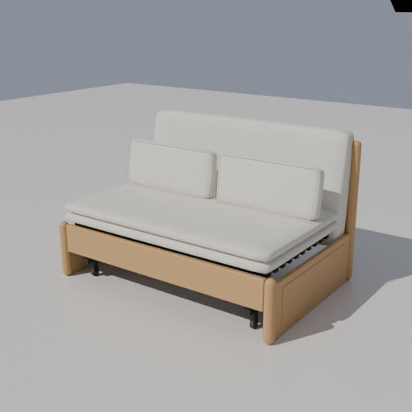
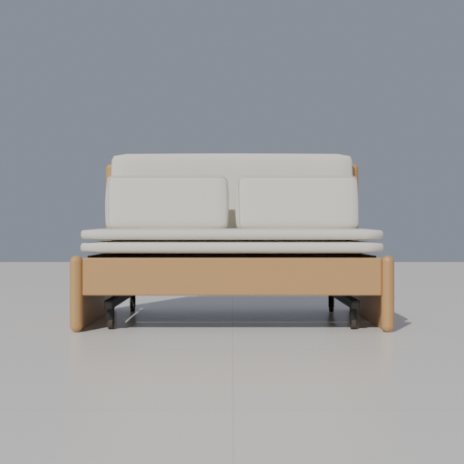
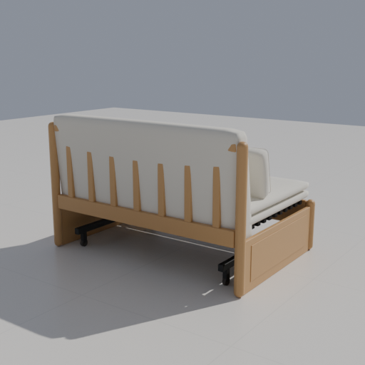

# Y107H03 · 1.25米沙发床增量验收

2026-10-31。最终制作源为 `assets/models/sofa-bed/v2/`，Blender实际程序经项目发现为Scoop `apps/blender/current/blender.exe`，版本5.2.3 LTS。来源与几何假设见[型号文档](../../SOFA-BED-YESWOOD-Y107H03.md)。本轮仅执行本款及受影响目录／产品规则／SVG专项，不代表其它91项重新通过。

## 已通过

- 作者预检与独立GLB回读发布：49件、唯一身份、米制单位、单部件材质、合法面索引与有限几何；六类故障注入被拒绝，静态产品的运动rig负例不适用。
- 真实Three生产网格：1250×838×770 mm、坐宽1180 mm、坐高400 mm、两层760×50 mm坐垫、靠垫560 mm、金属底架底85 mm；非标准宽深高缩放与稳定部件身份。
- `bodyParts()`／`directional()`：49件生产实体、外部间距、接触及0.1 mm穿入、包含边界与碰撞、旋转0/37/90°和镜像、高度分离／未知、吸附、项目与命名方案往返及重复恢复不漂移。
- HTTP及断网`file://`：尺寸编辑、撤销重做、缓存刷新、390 px窄屏；无脚本异常或外部请求。正式生产GLB的49件身份及世界边界，与独立Blender逐件回读一致。
- 三个固定机位使用实际生产导出，经正式渲染API输出512 px Cycles GPU图；实际设备与阶段保留于报告。API下载工程重新打开后核对生产几何、材质、相机和渲染设置。
- 同一正式打包EXE在独立源码目录、端口和缓存中读取 `D:/1601装修/Furnish项目/workspace.furnish.json` 的副本；新目录条目、尺寸撤销重做、正式文件保存刷新与三维显示通过，原文件哈希不变。
- `test-product-rules`、`test-furniture-svg`、`test-catalog-navigation`、`test-catalog-browsing`、`test-catalog-links`通过。受影响脚本语法和差异检查通过。

## 目视对照

已查看下列正式生产图和桌面截图，对照用户完整尺寸图及商品详情：无扶手轮廓、两层坐垫、长靠垫、双腰枕、前木栏／圆角柱、侧板和黑色底架均存在。木纹、布面、隐藏五金与软体鼓度为近似，尺寸通过不表示照片级还原或承重能力通过。

桌面截图见[实际EXE隔离场景](desktop-model.png)。这是正式文件的测试副本，不是对1601布置的修改。

## 可追溯记录与未执行

[整链路阶段](report.json)、[批次结果](batch.json)、[作者负例](preflight-negative.json)、[空间](spatial.json)、[HTTP／file导出](production.json)、[逐件回读](readback.json)、[三机位配置](studio.json)、[下载工程重开](reopen.json)、[桌面回执](desktop.json)及[来源哈希](source-hashes.json)均保留。原始运行目录为 `output/model-pipeline/selection-wlDInC/`，桌面为 `output/sofa-bed-desktop-o7KC5e/`。

未执行全量检查、展开状态及完整连续机械行程核对、任意尺寸组合、实物材质／承重／施工验证。没有新持久字段、迁移或独立保存通道；已保留原有用户工作区修改及真实方案。
