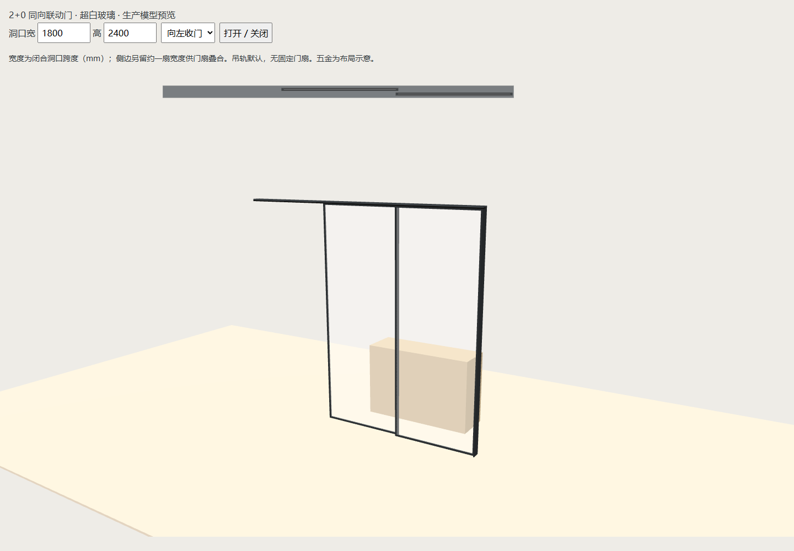
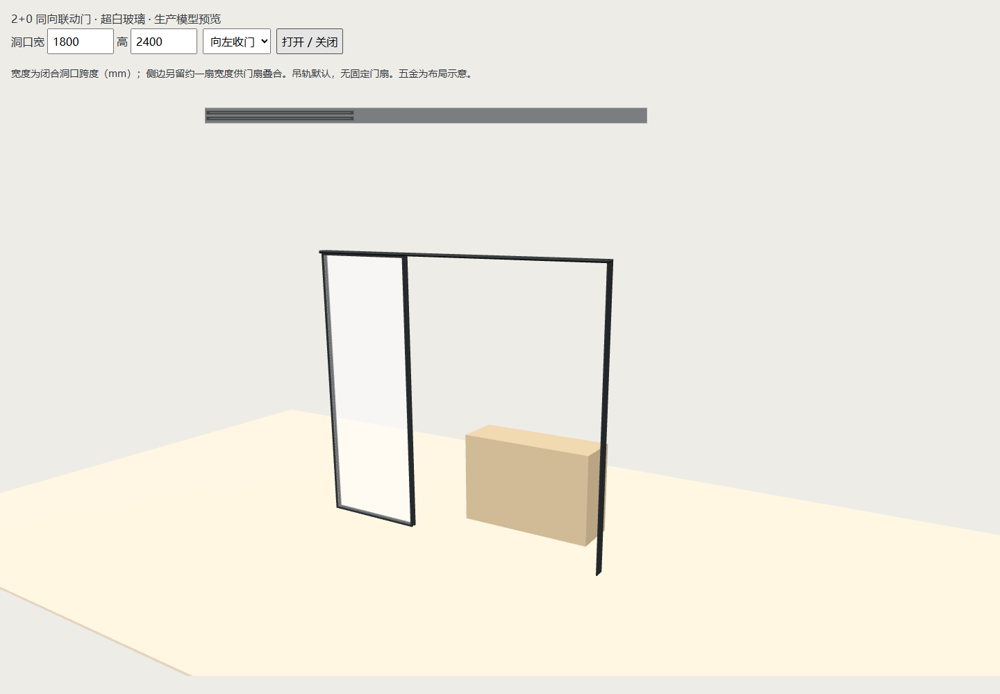
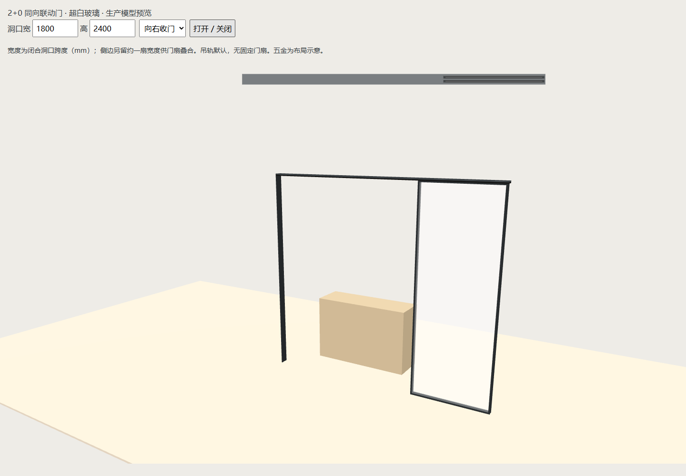
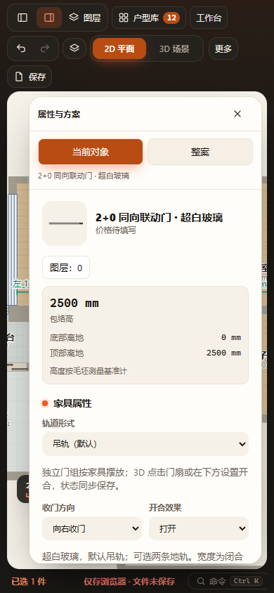
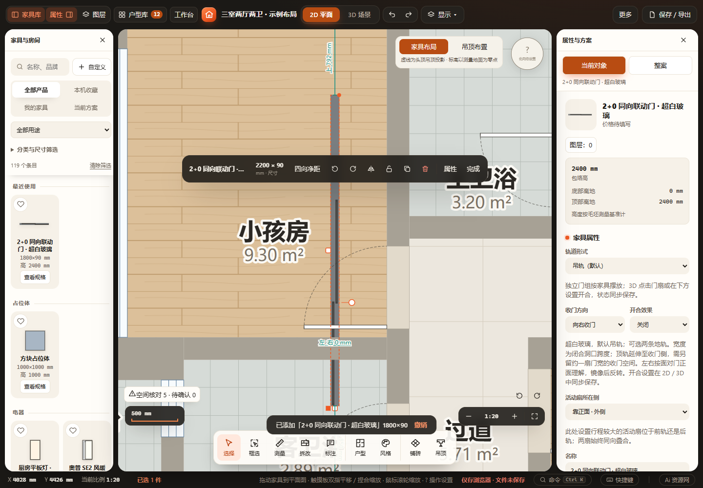

# 2+0 同向联动门验收（2026-10-27）

新增产品与字段契约见 [联动门说明](../../TELESCOPIC-OPENINGS.md)。预览由 `node scripts/preview-telescopic20.cjs` 生成到 `output/telescopic20/preview.html`，直接调用生产构造器；应用入口是家具库「门 · 隔断」的「2+0 同向联动门 · 超白玻璃」。

## 已通过

- 12 个本轮改动／新增脚本语法、主页面普通脚本共享声明和内联三维模块语法。
- Node 增量回归：`test-telescopic-20`、`test-telescopic-floor-tracks`、`test-telescopic-corners`、`test-product-rules`、`test-curtains-sliding`、`test-enclosed-boundary-distances`、`test-project-validation`、`test-work-state`、`test-furniture-recovery`、`test-furniture-solids-cache`、`test-furniture-solids-coverage`、`test-snapping`（均位于 tests，扩展名 .cjs）。
- 新产品 144 组实际 Three.js 门扇／轨道与数值实体对比，涵盖尺寸、轨道顺序、左右、旋转／镜像和两种姿态；无固定门扇、两条可选地轨、超白透明材质、2D 位置、缓存／确认失效、非法值、替换清理、重复恢复和项目／命名方案往返。
- Edge 隔离工作副本：HTTP 与断网 file:// 的宽高编辑、左右收门、2D/3D 开合、既有三维动画、复制、撤销／重做、自动缓存与刷新、390 px 属性面板，无 pageerror。命令 `node scripts/verify-browser.cjs telescopic20`，本机设置 `FURNISH_BROWSER_CHANNEL=msedge`。详细结果见 [browser-results.json](browser-results.json)。
- 已目视核对下列关闭、左右打开、窄屏截图，玻璃透明、门扇叠合和轨道连续。

## 未执行与边界

未运行全量 `node scripts/check.cjs`；本轮影响限于新门产品、共用滑门布局／构造／字段与其调用方，采用上述增量检查。未做实机触屏、真实 Blender 渲染或厂家施工核验；玻璃为实时透明外观近似，五金尺寸为布局估算。碰撞读取当前保存姿态的生产实体，未计算连续运动扫掠，也不自动切墙或建口袋。

浏览器初次运行发现沙箱内无 Chromium，Edge 在沙箱中启动即退出；使用已安装 Edge 在允许的隔离验收进程中完成。首轮浏览器脚本错误地寻找已移入浮动编辑器的 #fW，改用项目既有 editFurnitureField 后，HTTP／file 两种模式均通过。未改动真实 `projects/workspace.furnish.json`；其工作前已有的用户修改继续保留，未计入功能提交。

## 尺寸基点与吸附追加复验

追加 `tests/test-telescopic-20-placement.cjs`：40组旋转／镜像／收门侧／姿态下，数值改宽深及拖动改宽深保持实际收门端基点；完整轨道边界准确贴墙、临时绕过生效；真实UI放手避墙函数不会将正确贴边推离。相关 `test-snapping`、`test-drag-feature-snapping`、`test-product-plan-outline`、`test-enclosed-boundary-distances`、`test-telescopic-20`、`test-telescopic-corners` 通过。共享声明与改动脚本语法检查通过。

隔离HTTP／断网file浏览器增加基点坐标前后对比，真实鼠标拖动90°门的左右收门与镜像手柄，验证宽度改变而固定基点不动，并撤销恢复；数值编辑基点、复制、刷新、3D动画及窄屏再次通过。首次真实鼠标验收揭示放手推墙仍会移动基点，现已修正并通过复验。完整轨道外包参与吸附，不表示柜内空腔或连续运动扫掠；斜向自动避墙保留原轴对齐保守包络边界。本轮仍是增量检查，未执行全量检查或实机触屏。

