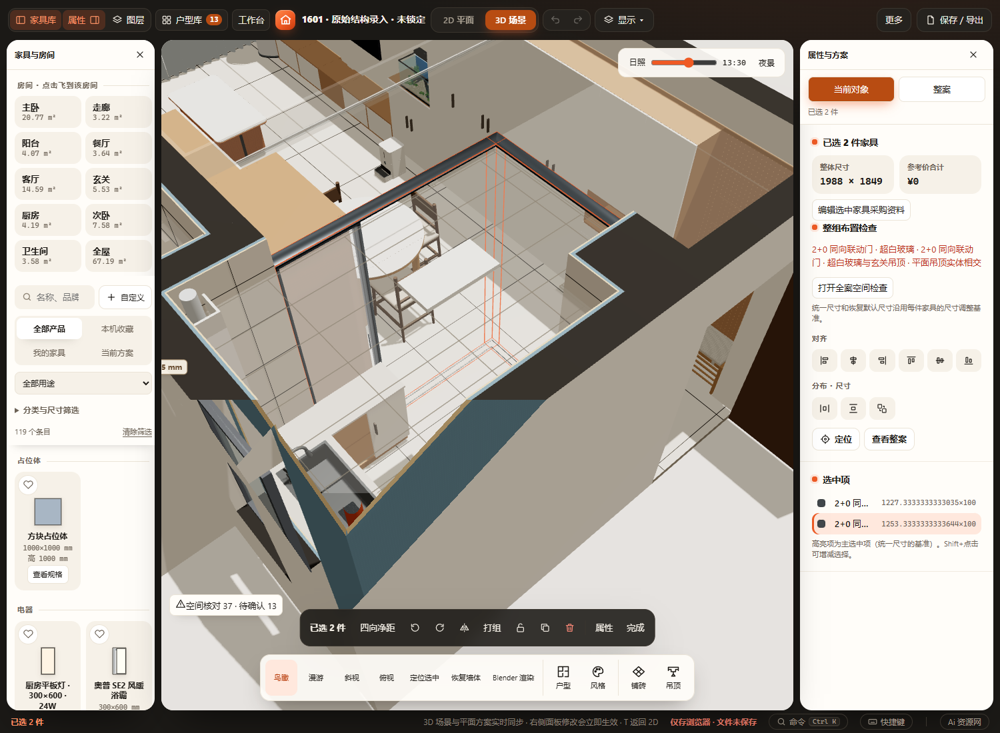
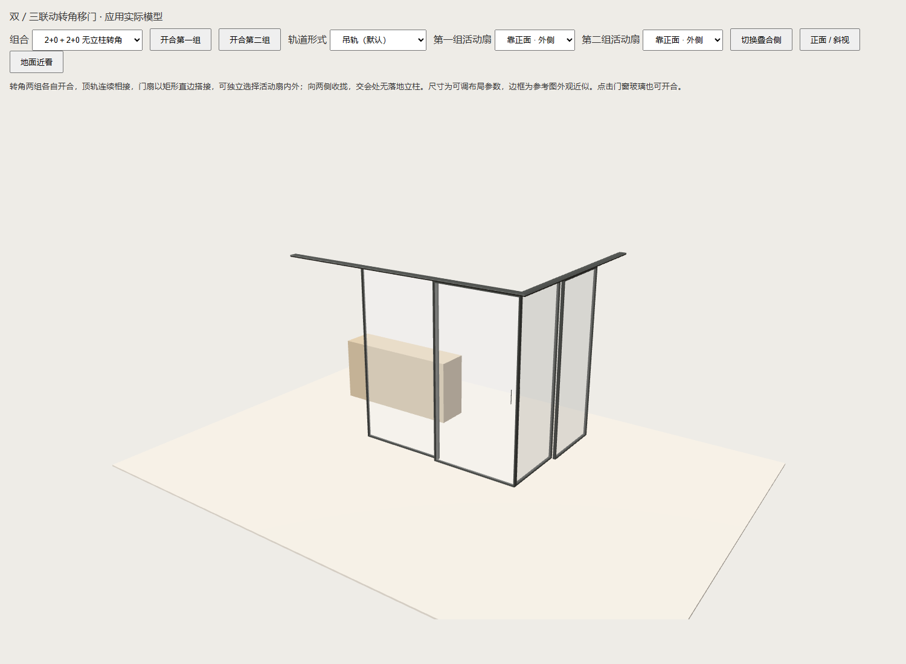
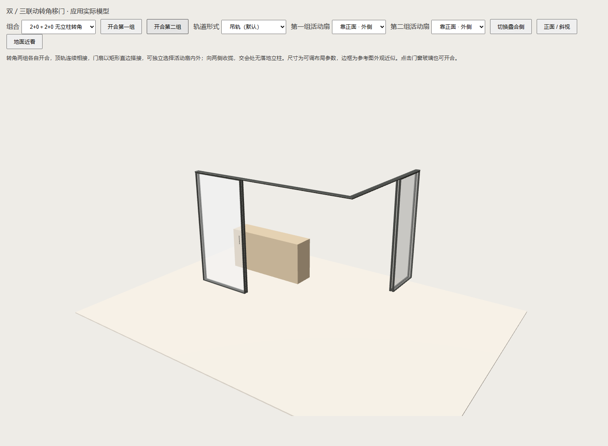

# 2+0转角无立柱验收（2026-10-28）

本轮修复截图中两组已打开2+0门交会处仍有固定竖框。参数和连接契约见 [联动门](../../TELESCOPIC-OPENINGS.md)。没有新增持久字段，原有用户方案文件不写入功能提交。

## 已通过

- `tests/test-telescopic-20-corners.cjs`：640组2+0互拼及新旧双／三联动混搭；旋转／镜像／前后轨／地轨；生产侧框数量、顶轨共边、全部活动扇BoxGeometry、关闭无实体穿插、打开叠合离开转角、收门远端固定基点、SVG和生产几何一致、选择轮廓、邻居变化失效、项目与命名方案往返。含用户当前两组位置的只读数值夹具，检查开／闭均无相互重叠；等于1 mm标高容差接受、超过拒绝，未知地面及向内收门回退，单向三组链不错误去柱。
- 相关Node增量回归：test-telescopic-corners、test-telescopic-20、test-telescopic-20-placement、test-telescopic-floor-tracks、test-sliding-door-glass、test-enclosed-boundary-distances、test-product-plan-outline、test-drag-feature-snapping、test-product-rules、test-project-validation、test-work-state、test-furniture-solids-coverage、test-curtains-sliding（均在tests，.cjs）。
- 改动脚本语法、主页面共享普通脚本作用域与内联三维模块语法。
- Edge隔离HTTP／断网file://：2+0＋2+0、2+0＋双联动、2+0＋三联动预览；用户当前方案两组门的真实生产构造无侧框、独立开合、收门方向回退及双方重建、撤销恢复、改尺寸保持远端基点、刷新后重新构造仍无柱。见 [browser-results.json](browser-results.json)。
- 已目视核对生产预览开／闭及当前方案二维和鸟瞰截图；转角没有固定竖框，选中时仅有原选择轮廓线。

命令：`FURNISH_BROWSER_CHANNEL=msedge` 下执行 `node scripts/verify/verify-telescopic20-corners.cjs --current-plan`。不带 --current-plan 使用隔离的普通测试门组。脚本只读取真实workspace快照，测试修改只进入独立浏览器的本地缓存，静态服务器不提供项目写接口。

首次新增混搭夹具错误地给旧门加了2+0专用字段，改正后发现旧薄门拉手与40 mm门扇真实相交，已由伙伴门厚退让修正。当前方案恢复核对最初按JSON原始键顺序比较，厨房已有派生配置重算仅改变键顺序，改为稳定键排序后验证家具键值完全保持；没有改写方案来通过断言。

## 未执行与边界

未跑全量check.cjs、实机触屏、Blender同步／渲染或厂家施工验证。仅匹配两组垂直关闭端、同高且朝外收门；不推断歧义伙伴，不模拟转角五金、受力或完整连续运动碰撞。当前方案已有的其它空间核对问题不属于本轮全部消除范围。主目录另一对话中的吊顶对齐源码及用户workspace修改保持独立，不纳入本次功能提交。
