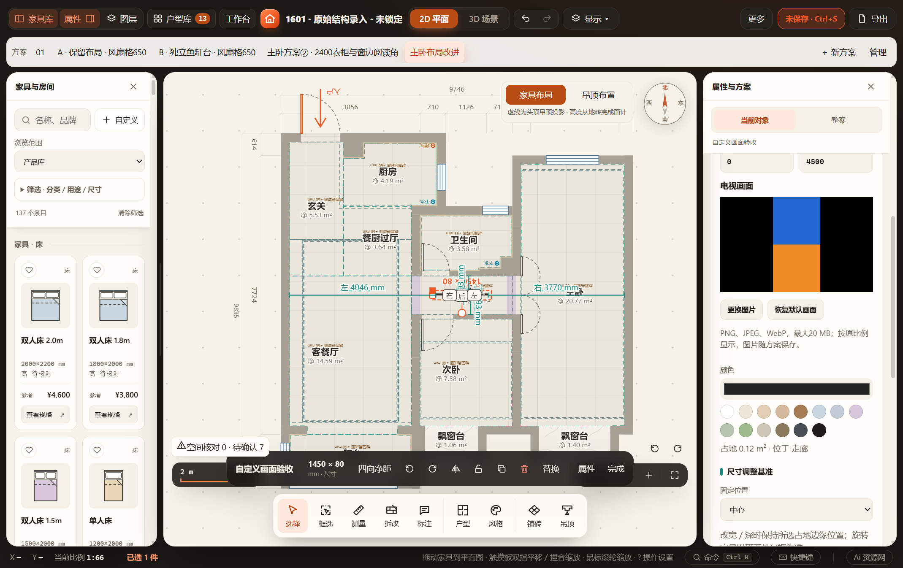
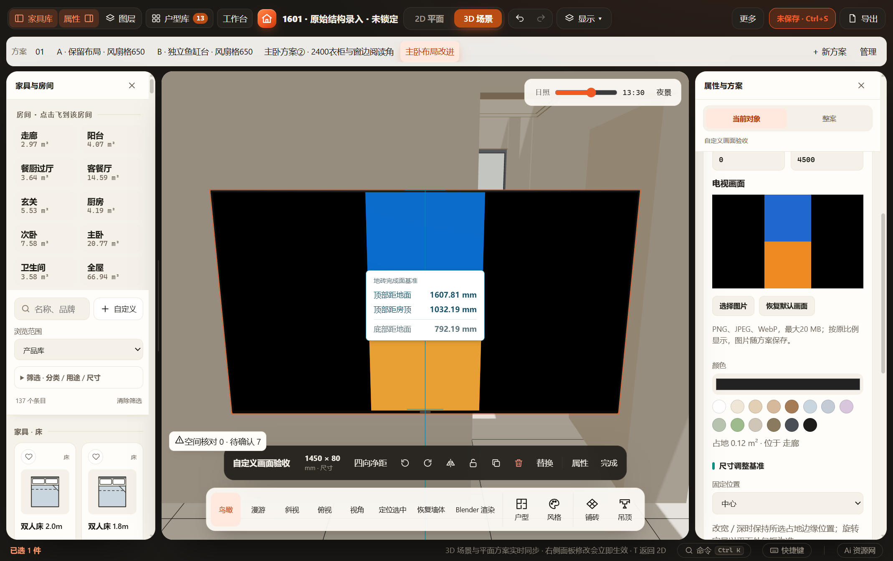

# 自定义电视图片（2026-10-31）

入口：选中通用电视 → 属性 → 电视画面 → 选择图片；恢复默认画面删除可选字段。所有操作在本机完成。

## 数据与显示契约

- 产品规则在 `product-rules.js` 注册 tvImage，仅适用于通用电视，OBJ 不支持；新建和旧缺失均不物化字段，继续显示既有默认山湖画面。
- UI 接受 PNG／JPEG／WebP，输入文件 ≤20 MiB、解码面积 ≤4000万像素；等比缩小至不超过1600×900、透明处铺黑、JPEG质量0.88，字段 data URL 总长 ≤2 MiB。拒绝外链、SVG及不符合签名／base64格式的数据；浏览器解码失败不提交修改。
- tvImage 保存自包含 PNG/JPEG data URL；普通 UI 统一产生 JPEG。项目／命名方案／工作区／缓存及复制保留，同类电视替换保留，换非电视由共用能力清理。带字段时使用项目／工作区 v41，恢复仍接受 v2–v40；旧数据不补新默认值，重复恢复无漂移。
- 生产屏幕使用独立1024×576 sRGB CanvasTexture，等比居中、黑边、不裁切；原几何、安装高度、尺寸与稳定身份不变。渲染签名覆盖图片，空间确认不读图片；图片更换不清空间确认。
- 自定义材质不进入全局材质缓存；生产 clearGroup 释放材质，dispose监听释放纹理并断开未完成的图片回调。默认画面仍共享。图片未加载完或导入数据损坏时，导出明确等待／重选；避免导出黑屏。无画布的数值实体路径仍使用原材质回退。

## 已通过

- `test-tv-image.cjs`：合法与错误字段／超限／外链／SVG／非电视，旧默认、同类与跨类型替换、复制、重复恢复、项目／命名方案／工作区 v41及v40缓存读取，图片修改不改变空间确认。
- `test-tv-view-consistency.cjs`：电视生产几何、全目录尺寸、自定义深度、旋转／镜像、垂直包络、二维对应与输入不变。
- `test-product-rules.cjs`、`test-work-state.cjs`、`test-workspace-cache.cjs`、`test-project.cjs`、`test-repository-version-compat.cjs`、`test-repository-workspace.cjs`、`test-repository-storage.cjs`；改动 JS 的语法与 diff 空白检查。
- `scripts/verify/verify-tv-image.browser.js`：HTTP 与断网 file:// 实际选择本地图片，压缩嵌入、一次撤销／重做、坏图保留旧图、3D实际生产屏幕像素（竖图蓝上橙下、两侧黑边）、恢复默认及撤销、旧材质和纹理dispose、锁定禁用、缓存刷新、390px无文档溢出。正式 GLB 中按专属 `Furnish TV picture` 材质查到基础色与自发光贴图以及内嵌 image bufferView。
- 同一 `output/desktop/Furnish-win32-x64/Furnish.exe`，独立工作目录／缓存／空闲端口，复制正式 `D:/1601装修/Furnish项目/workspace.furnish.json` 后执行相同流程，额外正式 flush 和刷新；原文件 SHA256 不变。

最终浏览器结果：`output/playwright/verification-48fs4D/results.json`；最终桌面结果：`output/tv-image-desktop/run-0VpT5p/results.json`。桌面运行脚本在忽略目录 `output/tv-image-desktop/verify.cjs`，只复制正式文件到隔离目录，不复制正式存储位置配置。曾修正生产屏幕遗漏所有权标记，最终恢复默认验证同时检查材质和纹理释放。针对刚撤销时立即导出的试验，原相机过渡保护先拒绝了导出；保留该保护，最终用例在稳定状态导出并精确检查电视贴图。

## 边界与未执行

没有运行全量检查或 Blender 工程回读；GLB 已检查实际内嵌图片，不能据此宣称所有渲染器颜色完全一致。自定义图是静态图片，透明图铺黑，图片经过有损压缩；没有视频／动图播放、裁切、外链或对单张图片作厂家色彩校准。导入校验检查数据格式与大小，像素解码仍由浏览器负责，损坏的伪造签名图会显示默认回退并阻止导出，需重选。
