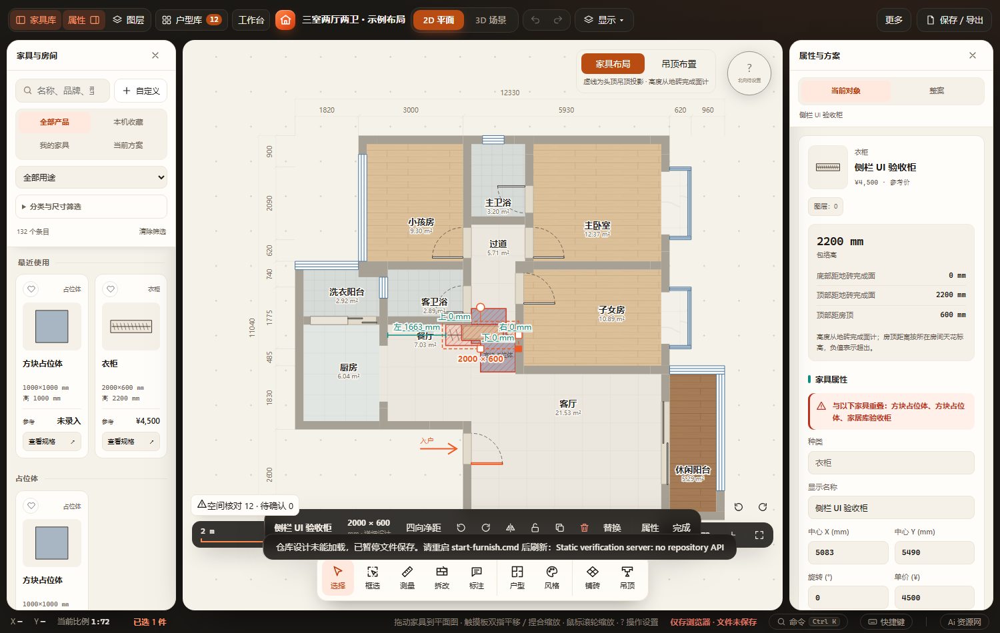
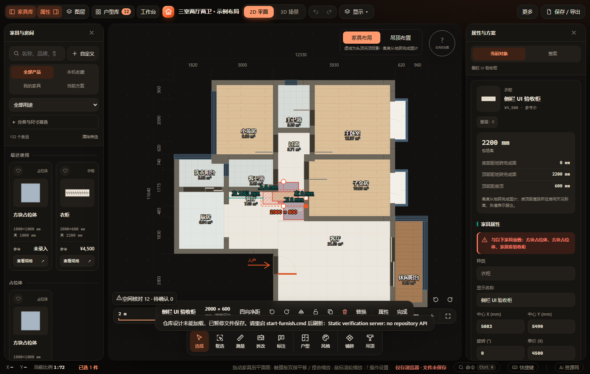
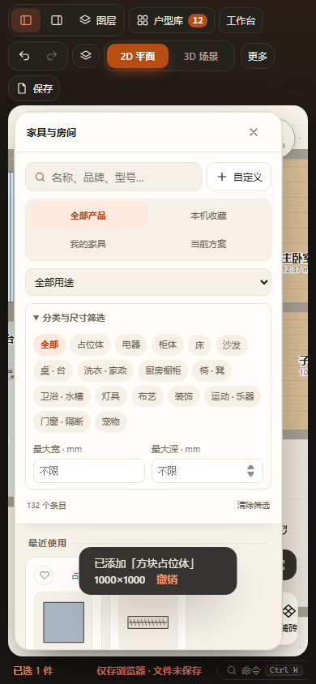
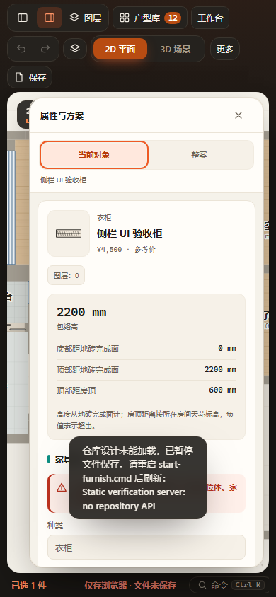

# 家具库与属性侧栏统一 · 2026-10-30

家具库复用原itemCard与目录数据，将卡片组织为收藏／种类、生产SVG缩略图、名称、宽深／高、参考价、规格入口。名称仍可由title查看完整内容；种类有屏幕阅读器前缀，避免将种类标签误读为另一个产品名称。未知价格与高度保留未知，自定义显式0价格正常展示。

属性侧栏保留原表单结构与控件ID、事件绑定、mutate／撤销／自动保存，沿原包络高及垂直测量口径，不恢复已去重的尺寸／移动操作。新增对象种类视觉标注，统一导航、对象摘要、图层入口、测量、表单、检查及操作区。仅1400px以上将家具库／属性侧栏调整为264／316px；1100px抽屉断点保持。样式局部限定于两侧栏，替换弹层和详细编辑器沿原流程。

## 已通过

- Node：catalog-browsing、furniture-replacement、laundry-stack、property-first-batch、property-second-batch。
- 浏览器（各含HTTP + 断网file://）：catalog-library、property-scopes、property-dedup、product-rules、furniture-replacement、current-furniture、property-open。
- 家具库：分类／用途／尺寸、搜索／收藏、规格、点击添加与拖放、自定义、显式0价格、删除来源保留实例、刷新。
- 属性：对象／整案范围、空间／安装参数、柜体和厨房入口、锁定与数据保留；新增侧栏名称编辑、一次撤销、重做与刷新检查。
- 脚本语法与git diff --check；浅色、深色、390px抽屉目视检查，无页面横向溢出。

最终家具库与侧栏截图：output/playwright/verification-Mtg8HK/results.json；其余首批5项通过见verification-M3RZla/results.json，current-furniture及property-open见verification-cWFX7E/results.json。运行全部使用副本与独立浏览器存储，未写用户项目文件。

两份旧VM夹具原先缺少生产入口已使用的ArmchairModel依赖／querySelector接口，已补齐真实依赖或假DOM接口，原断言保留。未修改生产模型来迁就夹具。未运行全量、真实手机触屏或其它浏览器引擎。

