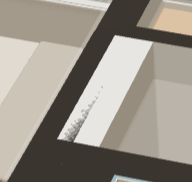
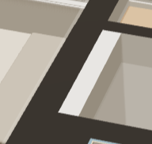

# 梁墙交接条纹验收 · 2026-11-03

## 原因与改动

1601主卧入口侧，墙体顶面与房梁顶面同为2700mm，平面部分重叠。生产墙体使用深色capMat，梁顶使用浅色wallMat；共面三角形的深度舍入不同，出现白色片区及梳齿条纹。

仅在index.html的themeMats中为墙顶专用capMat设置polygonOffset:true、polygonOffsetFactor:0、polygonOffsetUnits:-4。没有移动顶面、修改梁墙尺寸或持久字段；测距、碰撞、核对及导出几何沿原路径。固定深度偏移只用于本地栅格显示，不宣称会传播到Blender渲染。未采用斜率factor=-1：专项实测该值会掩盖1mm真实高度差；units=-1则仍有残余冲突。

## 实测

运行：`node scripts/verify-wall-beam-caps.cjs "D:/1601装修/Furnish项目/workspace.furnish.json"`。脚本将正式文件复制进独立源码目录，使用同一打包EXE、独立缓存及随机端口，不复制正式storage.json。测试结束核对正式源文件SHA-256不变；材质与视角对照前后snap不变，1mm高度负例仅在副本沿mutate／editBeam执行并撤销恢复。

- 程序：output/desktop/Furnish-win32-x64/Furnish.exe。
- 方案：1601／主卧调整2；原机位及邻近斜视，水平FOV60°。
- 重叠区内部924个采样点：关闭修正时924点为浅色；修正后原机位及斜视均0点为浅色。
- 梁顶改为2701mm、梁底2401mm：924点均恢复浅色梁顶，证明1mm真实高度差未被墙顶显示优先级掩盖。
- 页面异常0；正式源文件未改。已实际打开前后图及高度差负例目视复核。
- `tests/test-beam-heights.cjs`、`tests/test-beam-roof.cjs`、`tests/test-scene-shadow-cache.cjs`通过；覆盖生产挤出XYZ、剖切、梁高兼容／项目往返及阴影缓存。主页面内联模块及专项脚本语法检查通过。

原始运行目录：output/playwright/wall-beam-caps/2026-11-03T14-55-12-648Z（含独立副本、缓存和results.json，本机保留）。

| 同机位修正前 | 同机位修正后 |
| --- | --- |
|  |  |

斜视和1mm负例见[斜视](oblique.png)、[高出1mm](above-1mm.png)。

## 范围与边界

本次只验证上述桌面GPU与视距。未执行全量回归、直接file入口、其它GPU、暗色主题专项或Blender视觉验收；未修改加载机制。GPU深度精度仍有限，不将本次通过推广为任意远距离／亚毫米高度差保证。真实重叠几何保留；如需跨渲染器统一去重，须另行实现梁墙实体合并或面裁剪。
