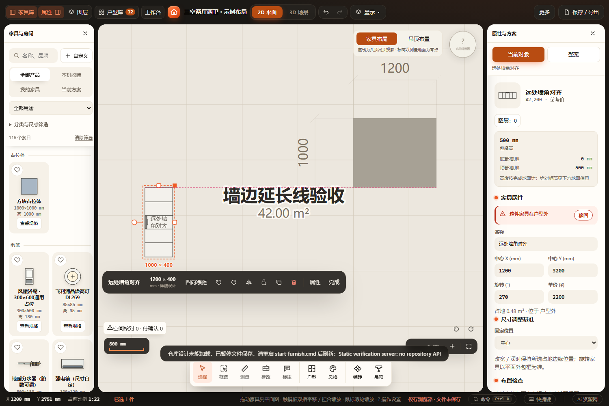

# 柜体对齐远处墙边延长线

2026-10-27。截图所示问题来自墙体吸附只接收投影重叠的有限边，而家具对齐已有远处基准。现在墙体吸附与对齐辅助线同时开启时，移动、普通柜宽深拉伸及厨房外边／边长拉伸允许对齐墙边延长线，沿边间隔上限6000 mm。关闭辅助线保留原有限贴墙行为；没有新增项目字段、保存通道或加载机制。

## 已通过

- `node --check src/core/snapping.js`、新增测试／浏览器脚本语法及 `git diff --check`。
- [Node检查](node-checks.log)：snapping、wall-extension-snapping、cabinet-boundary-snapping、drag-feature-snapping、kitchen-edge-snapping、drag-axis-lock、furniture-snapping-audit、finish-miter-snap 共8组。
- 新增回归覆盖两个尺寸轴、四个正交旋转及镜像、移动精确结果、50 mm捕获阈值等于／小于／大于、开关、6000 mm远距排除、固定锚点、厨房外边和重复三次项目往返；原有审计包含37°旋转和曲线有限边、2320次移动与2320次拉伸。
- [4组浏览器回归](browser-results.json)：wall-extension-snapping、cabinet-boundary-snapping、kitchen-edge-snapping、drag-axis-lock 均通过。每组日志同目录保存。
- 新增真实鼠标用例同时验证HTTP和离线file://：柜体上端对齐横向相隔2600 mm的墙角、拉伸后上端y=2800 mm、固定下端y=3800 mm、可见延长辅助线、撤销重做及缓存刷新后对象一致。
- [窄屏最终复验](browser-narrow-results.json)：等待侧栏收起后截图，HTTP及离线file://均通过。已人工查看桌面和390 px窄屏截图。

[离线同场景](file-resize.png) · [离线窄屏](file-narrow.png)

## 未执行及边界

未运行全量检查、Blender或触屏实机验收。测试用独立私有副本、静态服务和新浏览器配置，未写入用户仓库工作区；刷新验证原缓存通道。初次沙箱运行无法访问本机HTTP，使用沙箱外同一隔离工具后通过。

延长线是对齐基准，不代表物理接触，不改变实体碰撞／开启核对或模型尺寸合法性。普通柜拉伸优先有限接触，再选择延长线；曲线外轮廓仍按有限边真实支撑，不为无支撑截面推断远处接触。移动仍保留原网格、角点和实际边接触优先级。6000 mm为辅助线搜索边界，不是安装或净空要求。

工作区已有 `projects/workspace.furnish.json` 与 `src/ui/property-panel.js` 修改保留，不属于本次提交。其他对话的活动工作树保留，不在本次收尾中切换或清理。
