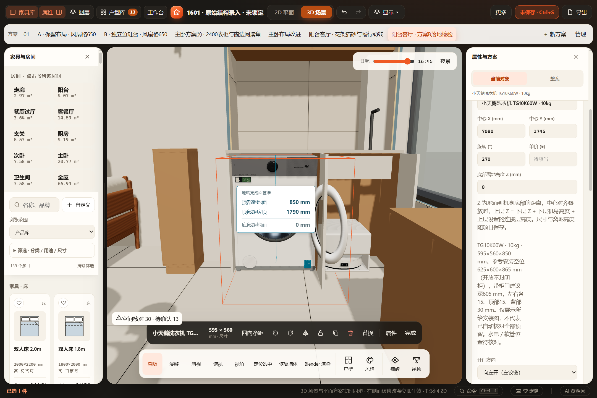
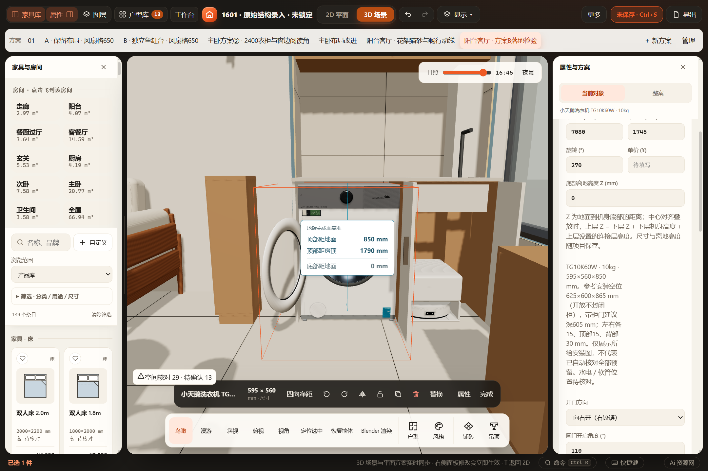

# 洗衣机圆门方向 · 2026-10-31

## 范围与依据

用户要求洗衣机开门方向可调、默认向左开。覆盖通用 washer 与小天鹅 TG10K60W；沿用既有尺寸、门径、轴心距离及110°上限，不重做外观或发布资产。新增 washerDoorSide=left/right，产品局部正面左右，跟随整机旋转／镜像。新建 left，旧缺失读 left 不补写。向右仅反射门组／门轴并反转转角，不反射固定机身。可选换向是布局能力，不证明实物支持换铰链。

截图的正式实例 flip=true，因此局部 left 在正面画面中向右；旧实例保持原姿态，使用新选项可单独反向。正式窗口由专用 MCP 只读核对：1601／阳台客厅·方案B落地检验，正式保存位于 D:\1601装修\Furnish项目\workspace.furnish.json，读取时存在未保存编辑。本次没有通过 MCP 修改正式方案。

## 已通过

- `tests/test-washer-door-side.cjs`：两款默认／枚举拒绝、生产Three与数值实体逐部件边界、左右当前轮廓、生产门体采样点被完整扫掠覆盖；旋转／镜像的左右实体碰撞、关闭分离与高度分离；复制／同族替换保留、换烘干机清理；定向空间确认，价格／配色不失效。
- v43项目／命名方案／工作区／恢复缓存往返、旧缓存回退、重复恢复无漂移，旧缺失不物化；目录版本检测。
- `test-blender-washer-asset.cjs`（通用与 --tg10k60w）：原有圆门、真实圆孔、改尺寸、五姿态、完整高度扫掠、稳定身份回归。
- `test-washer-project-v35.cjs`：旧方案／缓存／文件保存链。
- `test-product-rules.cjs`、`test-work-state.cjs`、`test-workspace-cache.cjs`、`test-washer-front-confirmation.cjs`：产品能力与兼容链路增量回归。
- 改动JavaScript模块语法及 `git diff --check`。
- 同一打包EXE、独立源码／缓存／端口，复制外置正式存档进行验收：默认left、UI选择right、键盘撤销重做、保存刷新、390px无页面溢出、生产WebGL左右端态。复制源文件的运行前后哈希一致；不覆盖正式文件或缓存。桌面验收输出：`output/playwright/washer-door-side-1793459310397`。
- 离线 file:// 独立浏览器：方向UI、保存刷新、生产WebGL通过。
- 生产GLB左右两方向／两款共四份，750×700×1000mm、底部200mm、110°开门；Blender5.2.3LTS按每个稳定部件键回读世界边界，15／47件完整，最大误差 <0.00027mm。见 [回读结果](blender-readback.json)。本机导出位于 `output/playwright/washer-side-export`。

## 目视与边界

实际查看下面两张正式生产场景截图：门组分别位于另一侧，机身面板／旋钮／文字不随方向改变；原整机镜像仍保留。图片为隔离副本，没有把验收编辑写入正式方案。聚焦标签覆盖中央部分，不用于重新判定材质或近照还原度。

未执行全量检查、重新制作／发布Blender源资产、全屋正式方案写入或重新进行材质摄影渲染。后两项不属于本次方向配置范围；完整行程仍为既有12高度片保守包络，不宣称逐三角面连续精确碰撞或厂家施工验证。
