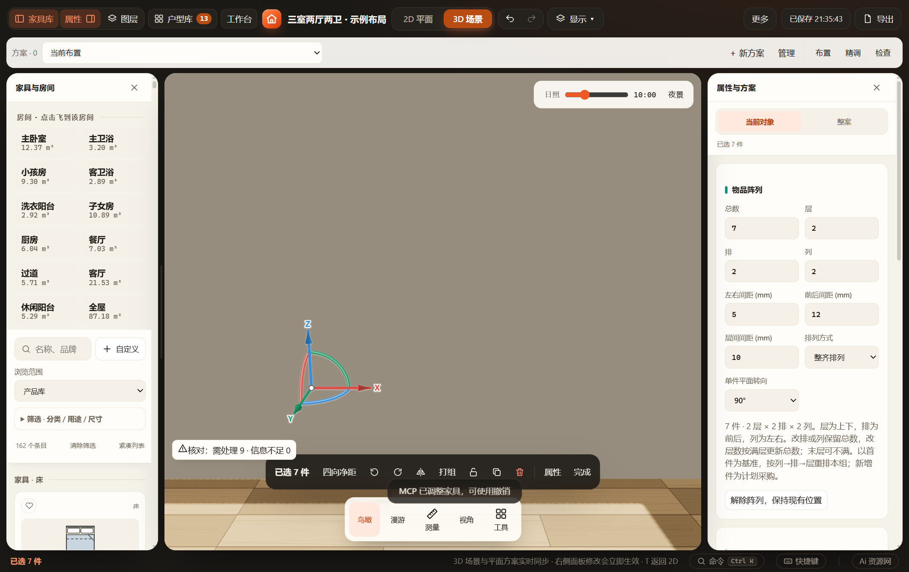
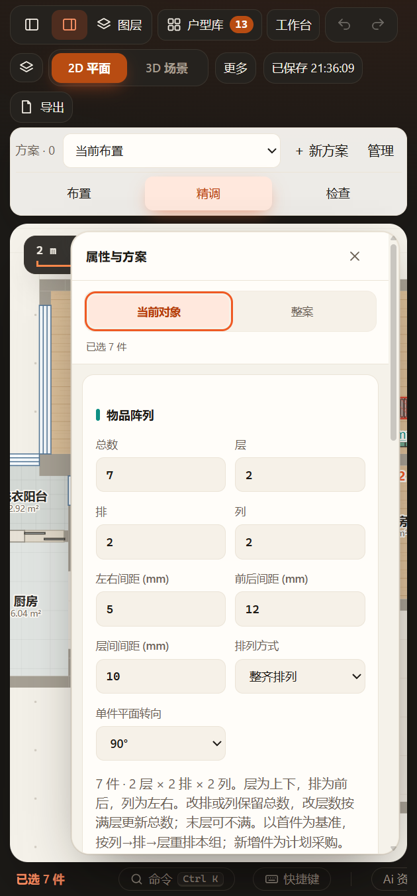

# 湿巾关联阵列验收（2026-11-07）

沿用现有湿巾170×110×70mm生产资产，只接入关联阵列；契约见[物品阵列](../../INVENTORY-ARRAY.md)。正式方案未修改，未刷新正在编辑的正式窗口。

## 通过

- `tests/test-inventory-array.cjs`：湿巾纳入原位转换、实际生产实体、旋转／镜像、数量／末层、间距／转向、复制／替换、锁定、采购及往返回归。默认配方读取不修改旧单件；未启用阵列仍v57，显式湿巾阵列v65，旧类型保持v63／v64。
- `tests/test-inventory-array-ui.cjs`：同一打包EXE、独立数据／缓存／端口；未转换湿巾显示默认数量，首次改7件一次撤销回到原始单件并可重做；行列／层／间距／90°转向、非法负间距、MCP配置、保存／刷新、窄屏及解除通过。HTTP与阻断HTTP网络的file入口也可从原单件编辑数量。[运行报告](ui-report.json)。
- 实际生产GLB导出：7包、每包原4部件，共28部件；2层、70mm单件高与10mm层间距对应150mm整体高。完整GLB及运行证据保留于 `output/playwright/inventory-array-vpgLIu/`。
- 产品规则、纸品阵列、storage-supplies、家具分组与repository-storage定向回归通过；改动脚本语法检查通过。
- 已实际查看下列宽／窄屏面板：总数、层、排、列及间距可读，窄屏面板可滚动。宽屏截图用于参数控件验收，当前镜头未对准测试湿巾；不能据此宣称完成模型外观复核，生产几何按上项导出检查。

## 未执行与边界

未运行全量检查；未重建或精修Blender资产，本次不评价外观还原度。错位排列不证明堆放稳定性，实际单件仍参与原净距／碰撞。成功测试副本的源码与缓存已清理，报告／截图／导出保留；正式用户数据及其他会话修改保留。正式窗口保存后刷新可加载新控件。
